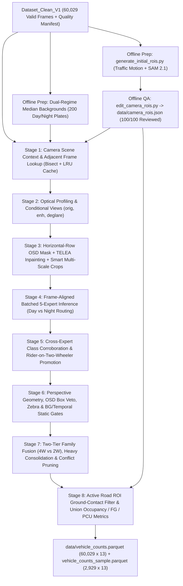

# Task 03 Technical Architecture & Methodology (`PIPELINE_ARCHITECTURE.md`)

> **Module:** [`03_cv_yolo_pipeline/`](GOAL.md) | **Owner:** เฟิร์ม ([@nontaphatfirm](https://github.com/nontaphatfirm))  
> **Scope:** Full Computer Vision & Spatio-Temporal Feature Extraction across `60,029` valid `V2.1` BMA CCTV frames (`100` cameras)  
> **Primary Implementation:** [`src/robust_detector.py`](src/robust_detector.py), [`src/run_batch_cv_pipeline.py`](src/run_batch_cv_pipeline.py), [`src/generate_initial_rois.py`](src/generate_initial_rois.py), [`src/edit_camera_rois.py`](src/edit_camera_rois.py), [`Colab_A100_Batch_Detection.ipynb`](Colab_A100_Batch_Detection.ipynb)

---

## Executive Summary

Standard single-model object detectors fail severely on Bangkok Metropolitan Administration (BMA) CCTV snapshots (`352 x 288` px on 99 cameras; `348 x 261` px on `cam_id=395`) due to:
1. **Low resolution & distant queues:** Distant cars/motorcycles occupy `< 8 x 8` pixels near the upper horizon.
2. **OSD Timestamp & Camera-ID Overlays:** Bright/green text strips across the top `12%` and bottom `16%` occlude vehicles and trigger false detections.
3. **Static Scene Traps:** Roadside billboards (e.g., ZONTES motorcycle posters), painted crosswalk zebra bars, shopfronts, and parked cars repeatedly trigger frame-invariant false positives.
4. **Nighttime Glare & Wet-Road Reflections:** Intense headlight bloom, rain haze, and specular road reflections hide dark vehicles while creating phantom two-wheeler hallucinations.
5. **FOV & Perspective Heterogeneity:** Raw vehicle counts cannot be compared across tightly zoomed intersections vs. elevated wide-angle footbridges without active road surface normalization.

**Task 03** solves these failure modes via an **8-stage physics-informed multi-expert detection pipeline** combining **6 pretrained domain-specialist YOLO weights** (`5` active in daytime, swapping in a nighttime automotive specialist under low light/glare), **dual-regime Median Backgrounds**, **adjacent-frame temporal gating**, **SAM 2.1 + 100/100 human-reviewed Road ROIs**, and **frame-aligned GPU batch inference**. The pipeline produced all canonical deliverables (`data/vehicle_counts.parquet` with `60,029` rows, `data/vehicle_counts_sample.parquet` with `2,929` pilot rows, `200` day/night background plates, and `100` reviewed Road ROIs) passing `DATA_CONTRACT.md` verification.

---

## End-to-End System Architecture

---

## 1. Offline Spatial Calibration & Scene Assets

### 1.1 Dual-Regime Median Backgrounds (`CameraSceneProvider`)
To prevent illumination shifts from breaking background subtraction at dusk or night, [`CameraSceneProvider`](src/robust_detector.py) builds and caches **two clean-road background plates per camera** in [`data/median_backgrounds/`](../data/median_backgrounds/) (`200` `.jpg` files total):
- **Daytime plate (`<cam_id>_bg.jpg`):** Pixel-wise temporal median of up to `35` valid frames from `hour` `9..16` (fallback if `< 5` frames: frames above the `60th` percentile of `brightness_mean`).
- **Nighttime plate (`<cam_id>_bg_night.jpg`):** Pixel-wise temporal median of up to `30` valid frames from `hour >= 19` (fallback if `< 5` frames: frames at or below the `35th` percentile of `brightness_mean`).
- **Runtime Acceleration:** Uses a `96`-frame thread-safe LRU decode cache (`_read_bgr_cached`) and `O(log N)` binary search (`bisect_left` / `bisect_right` over epoch timestamps) to retrieve the nearest preceding and following same-day frames within `60s < |dt| <= 1,800s`, eliminating redundant JPEG decodes across consecutive frames.

### 1.2 Traffic-Guided SAM 2.1 & Human-Reviewed Road ROIs
Active drivable road polygons are generated in two passes by [`generate_initial_rois.py`](src/generate_initial_rois.py) and manually audited across all `100/100` cameras via the interactive GUI editor [`edit_camera_rois.py`](src/edit_camera_rois.py):
1. **Pass 1 (Dynamic Motion & YOLO Evidence):** Samples up to `128` daytime/shoulder frames for two-way pixel motion (`|I - bg| > 14` and `|I - neighbor| > 12`) and up to `48` frames for batched YOLO detection (`yolo26x.pt` at `conf=0.22`, `visdrone-yolo26l` at `conf=0.26`, `imgsz=448`), retaining only dynamic boxes (`fg15 >= 0.22`, `Sobel NCC < 0.62`, removing long-horizon parked cars with `IoU >= 0.65` in `>= 50%` of sampled frames).
2. **Pass 2 (Traffic-Guided SAM 2.1 Segmentation):** Prompts `sam2.1_b.pt` on `bg_day` with `5 x 4` spatially stratified traffic centroids and automatic negative anchors (above-horizon sky, chlorophyll-verified green foliage/medians, static parked bays, zero-motion dead zones), emitting `4–14` vertices per separated carriageway polygon while preserving dividers/medians (`data/camera_rois.auto_v3_backup.json` snapshot).
3. **Human Audit (`100/100` Reviewed):** Every camera polygon in [`data/camera_rois.json`](../data/camera_rois.json) was visually inspected against rush-hour traffic frames (`reviewed: true` on `100 / 100` cameras), reshaped with vertex drag / knife split / multi-polygon tools to exclude parking bays, sidewalks, bridges outside focus, and opposite non-target lanes where appropriate.

---

## 2. Six-Weight Multi-Expert Ensemble & Class Unification

### 2.1 Domain-Specialist Checkpoints (`EXPERT_SPECS`)
No single pretrained YOLO checkpoint excels across both crisp foreground heavy vehicles and tiny overhead/nighttime motorcycles. [`RobustTrafficDetector`](src/robust_detector.py) caches **6 checkpoints locally in `models/`** and selects **5 active experts per optical regime**:

| Model Key | Local Weight Path (`models/`) | Domain Family (`_model_family`) | Active Regime | Fusion Prior | Class Weight | Specialized Role |
| :--- | :--- | :---: | :---: | :---: | :---: | :--- |
| `uvh26` | `iisc-aim--UVH-26/UVH-26-MV-YOLOv11-X.pt` | `uvh26_fam` | Day + Night | `1.02` | `1.25` | Asian two-wheelers, three-wheelers, compact urban cars |
| `visdrone` | `dronefreak--visdrone-yolo11x/best.pt` | `visdrone_fam` | Day + Night | `0.96` | `0.90` | Dense/small far-field queues & elevated footbridge views |
| `visdrone26l` | `dronefreak--visdrone-yolo26l/best.pt` | `visdrone_fam` | **Day Only** | `0.95` | `0.90` | Complementary aerial YOLO26 architecture for distant traffic |
| `bdd100k` | `dronefreak--bdd100k-yolo26m/best.pt` | `bdd_fam` | **Night Only** | `1.05` | `1.25` | Automotive night/glare specialist (replaces `visdrone26l` at night) |
| `yolo26x` | `yolo26x.pt` | `coco_fam` | Day + Night | `1.06` | `1.35` | High-precision COCO anchor for cars, buses, trucks, riders |
| `yolo11x` | `yolo11x.pt` | `coco_fam` | Day + Night | `1.04` | `1.25` | Complementary COCO cross-voting anchor under rain/occlusion |

### 2.2 Canonical 4-Class Schema & Cross-Model Guards
Raw predictions from COCO, VisDrone, UVH-26, and BDD100K are mapped into **4 canonical classes (`CANONICAL_ID_TO_NAME`)** matching [`DATA_CONTRACT.md`](../DATA_CONTRACT.md):
- **`0: car`** — merges `car`, `sedan`, `hatchback`, `suv`, `muv`, `van`, `taxi`, `tempo`, `auto-rickshaw`, `tricycle`, `awning-tricycle`, `three-wheeler`. Boxes originating from `tricycle`/`awning-tricycle`/`three-wheeler` carry `from_three_wheeler=True` / `has_3w_vote=True` so lower-frame perspective area floors (`42 px²` vs `125 px²`) still retain compact tuk-tuks/three-wheelers while counting them as `car`.
- **`1: motorcycle`** — merges `motorcycle`, `motorbike`, `motor`, `two-wheeler`. *(Note: `bicycle` is excluded to track motorized traffic.)*
- **`2: bus`** — merges `bus`, `mini-bus`.
- **`3: truck`** — merges `truck`, `pickup`, `lcv`, `mini-truck`, `van-truck`.

Model-domain quirks handled explicitly at extraction & corroboration time:
- **UVH-26 sub-crop guard:** Drops `uvh26` `bus`/`truck` predictions from cropped sub-views (`crop_tag not in {"full", "full_osd"}`), avoiding frequent stair/crosswalk/signboard false heavy detections.
- **VisDrone oblique-sedan `truck` guard:** Marks `visdrone`/`visdrone26l` `truck` predictions with `area <= 8%` of frame area as `is_weak_truck` and downgrades them to `car` unless corroborated (`IoU >= 0.35`) by `COCO | BDD` heavy detections or high-confidence `uvh26` (`conf >= 0.45`).

---

## 3. Detailed 8-Stage Detection & Physics Filtering Pipeline

### Stage 1: Scene Context & Road Mask Resolution
- Resolves `(cam_id, timestamp, hour)` strictly from standardized ASCII filename `<cam_id>_<YYYYMMDD_HHMMSS>.jpg` (ignoring corrupted `1970` CMOS OSD dates).
- Loads cached `bg_day`, `bg_night`, active `roi_mask`, and adjacent frames (`prev_img`, `next_img`). Adjacent temporal filtering is activated only against neighbors exhibiting real traffic movement (`MAD >= 2.5`) so brief camera stalls never erase stopped vehicles.

### Stage 2: Optical Profiling & Conditional Enhancement (`build_optical_views`)
Computes `brightness_mean`, `contrast_std`, `glare_ratio = mean(gray > 240)`, and `laplacian_var = var(Laplacian(gray))`:
- **Regime Triggers:**
  - `is_night_or_glare = (hour >= 18) or (brightness_mean < 90.0) or (glare_ratio > 0.045)`
  - `is_low_contrast_or_rain = contrast_std < 34.0`
- **Synthesized Views:**
  - `"orig"`: Unmodified original BGR frame (always run).
  - `"enh"` *(night/glare or rain/low-contrast)*: Compresses specular highlights above `L > 210` (`0.30x` slope at night) or `215` (`0.35x` in daytime rain), applies LAB CLAHE (`clipLimit=2.3` night / `2.2` day, `8x8` tiles) + gamma LUT (`0.68` if dark `< 90`, `0.76` if bright glare, `0.78–0.90` in daytime rain), plus mild unsharp masking (`1.18, -0.18`) only on blurred night scenes (`laplacian_var < 350`).
  - `"deglare"` *(night/glare only)*: Stronger highlight compression above `L > 160` (`0.28x` slope), gentler CLAHE (`clipLimit=2.0`), gamma `0.88`, and zero unsharp sharpening so headlight halos compress without creating false texture edges.

### Stage 3: Precision OSD Inpainting & Full-Height Multi-Scale Crops
- **`build_osd_mask`:** Detects thin high-contrast/green glyph strokes (`_high_contrast_text_strokes` relative to `9x9` median blur) restricted to top `12%` and bottom `16%` bands (`8 <= green` or `>= 10` static-BG stroke match). `_filter_osd_text_rows` retains only horizontally collinear text rows (`>= 5` character components within `+-6 px` vertical center and spanning `>= 45 px`) to avoid erasing vehicles.
- **Inpainting & Cropping (`build_smart_crops`):** Applies `cv2.inpaint(img, osd_mask, 3, cv2.INPAINT_TELEA)` to generate clean sub-crops while preserving raw `"full"` intact:
  - `"full"` (`orig` / `enh` / `deglare` un-inpainted `0..W, 0..H`), `"full_osd"` *(when `osd_mask.any()`)*
  - `"far_mid"`: `[0.08W, 0.02H, 0.92W, 0.65H]` (zooms distant upper-horizon queues)
  - `"lower_road"`: `[0.04W, 0.32H, 0.96W, H]`
  - `"lower_left"`: `[0, 0.30H, 0.62W, H]` and `"lower_right"`: `[0.38W, 0.30H, W, H]`
- **Boundary-Safe Routing:** Sub-crop detections touching an interior cut edge within `3.0 px` are dropped to avoid double-counting truncated vehicles; night `visdrone` is restricted to `full`/`full_osd`/`far_mid` crops (`raw_conf=0.16`, others `0.12` at night, `0.14` daytime).

### Stage 4: Frame-Aligned GPU Batch Inference (`predict_batch`)
- Groups `(frame_idx, model_crops)` into buckets keyed by `(model_key, eff_raw_conf, (img_w, img_h))` and dispatches **frame-aligned chunks** (`<= yolo_batch` crops total, never splitting a frame's crop list mid-frame). Every GPU forward pass contains complete crop sets (including `"full"`), guaranteeing identical Ultralytics letterboxing dimensions to single-image `predict()`.
- Auto-adapts precision kwargs via `ultralytics.cfg.DEFAULT_CFG_DICT`: passes `quantize=16` on Ultralytics `>= 8.5` and `half=self.use_half` on `<= 8.4.51` (when CUDA is available).

### Stage 5: Class Corroboration & Rider-on-Road Promotion
- `_corroborate_classes`: Resolves `is_weak_truck` and applies `0.85x` penalty to uncorroborated `uvh26` heavy predictions (`conf < 0.45`).
- `_promote_riders_to_motorcycles`: Filters valid external riders (`person`, `pedestrian`, `rider` from `COCO | VisDrone`, or `rider` from `bdd100k`), rejects riders inside 4-wheelers (`IoMin > 0.40`), and when a rider overlaps a two-wheeler (`IoU >= 0.12` night / `0.15` day or center distance `< 16 px` night / `14 px` day) synthesizes a combined `rider+motorcycle` vote boosted by `+0.12` (capped at `0.92`) — never promoting standalone pedestrians.

### Stage 6: Perspective Geometry, OSD Box Veto, Crosswalk & Background Gates
- **Perspective Geometry (`_filter_by_geometry`):** Aspect ratio `w/h in [0.22, 4.2]`, height `>= 7 px` on frame top/bottom edges; `2W`: `w >= 4.0`, `h >= 6.0`, `area in [28, 0.048*frame_area]`; `car`: `area >= 24`, `area <= 0.24*frame_area` (`<= 0.075*frame_area` if `yc < 0.45*H`); `bus/truck`: `area <= 0.85*frame_area`.
- **Two-Row OSD Veto (`_is_osd_text_box`):** Drops boxes `h <= 28 px` in top/bottom bands (`y2 <= 0.14H` or `y1 >= 0.77H` night; `0.13H / 0.83H` day) with OSD pixel overlap `> 0.20` (night) / `> 0.28` (day).
- **Sobel NCC, Zebra Crosswalk & Parked Gates (`_is_static_or_parked`):** Computes OSD-masked `fg_bg_15`, `fg_bg_25`, max Sobel gradient normalized cross-correlation against `bg_day`/`bg_night` (`ncc_edge_bg`), adjacent-frame `min_fg_adj` and `max_ncc_adj`, nighttime light contrast check (`has_light_contrast`: `p95 - p20 >= 48` or `max >= 190 & std >= 18`), and crosswalk bar detector (`_has_zebra_oscillation`: resizes patch to `24x24` and rejects periodic painted bars with row/col mean zero-crossings `>= 4.2` and `ncc_edge_bg >= 0.28`):
  - **Daytime veto:** Rejects background structures (`fg_bg_15 < 0.20`, `ncc_edge_bg >= 0.68`, or `ncc_edge_bg > 0.50 & fg_bg_25 < 0.38`) and unmoved parked boxes (`min_fg_adj < 0.16 & max_ncc_adj > 0.55`, or `max_ncc_adj >= 0.75`).
  - **Nighttime illumination-invariant veto:** Uses Sobel `ncc_edge_bg` (`>= 0.56` unconditional; `>= 0.46` paired with `max_ncc_adj >= 0.68`), dark shadow rejection when `not has_light_contrast` (`fg_bg_25 < 0.05` or `fg_bg_15 < 0.16`), and off-ROI / single-model temporal gates (`min_fg_adj < 0.10 & max_ncc_adj > 0.65`).

### Stage 7: Two-Tier Weighted Fusion, Heavy Consolidation & Pruning
- **Two-Tier Group Clustering (`_cluster_group`):** Clusters within `GROUP_4W = {"car", "bus", "truck"}` (`IoU >= 0.38`) and separately within `GROUP_2W = {"motorcycle"}` (`IoU >= 0.34`, or `IoMin >= 0.66 & area_ratio >= 0.28`, or center-distance match) so adjacent cars and motorcycles never suppress each other. Computes prior-weighted top-6 coordinate average, weighted class voting, and family-independent confidence boost (`+0.06` multi-model same family, `+0.10` `>= 2` families, `+0.16` `>= 3` families).
- **Quality & Night Glare Gates (`_passes_quality_and_glare_gates`):** Suppresses VisDrone-only tiny/wet-road hallucinations, nighttime saturated glare streaks (`gray > 220 > 60%` with flat std `< 8.0`), dark phantom single-model spots (`gray < 50 > 78%`), large low-conf LED billboards (`area >= 1,200` with `max_raw_conf < 0.20`; upper `area >= 2,000` with `< 0.30`), and tight nighttime `2W` aspect/area guards (`ar in [0.32, 1.65]`, lower-frame area `>= 110` for `yc > 0.65H`). Thresholds kept clusters at final confidence `conf >= 0.25`.
- **Consolidation & Conflict Resolution:** `_consolidate_giant_heavy_vehicles` recovers close-up buses/trucks (`area >= 8%` frame), followed by `_prune_4w_wrappers` (drops wrapper boxes enclosing `>= 2` children), `_prune_within_group_nested`, `_suppress_heavy_vehicle_subparts`, and `_resolve_cross_group_conflicts` (resolving 4W vs. 2W overlap/sub-box conflicts).

### Stage 8: Active Road ROI Ground-Contact Filter & Metrics
- **`RoadRoiProvider.box_in_roi`:** Retains a vehicle if its ground-contact anchor `(0.5*(x1+x2), 0.85*y2 + 0.15*y1)` falls inside `roi_mask` **or** `>= 35%` of its bounding-box pixels overlap `roi_mask` — ensuring tall foreground buses/trucks extending upward past the horizon ROI boundary remain counted.
- **Canonical Metrics:** Computes pixel-exact union `bbox_total_area` (no overlap double-counting), `road_roi_area = max(sum(roi_mask > 0), 0.15 * W * H)`, `road_occupancy_ratio = round(bbox_total_area / road_roi_area, 4)`, `foreground_ratio = round(((|gray - gray_bg_active| > 25) & (roi_mask > 0) & ~osd).sum() / road_roi_area, 4)`, and `pcu_score = 1.0*car + 0.33*motorcycle + 2.5*bus + 2.5*truck`.

---

## 4. Batch Execution & Google Colab A100 Engineering

- **Parallel CPU + GPU Pipeline ([`run_batch_cv_pipeline.py`](src/run_batch_cv_pipeline.py)):** Pre-builds optical/crop inputs (`Stage 1–3`), finalizes post-clustering gates (`Stage 5–8`), and renders annotated `.jpg`s (`draw_detections`, `scale=1.5`, JPEG quality `90`) concurrently via `ThreadPoolExecutor`, while `resolve_batch_defaults()` auto-tunes `(batch_frames, yolo_batch)` by GPU VRAM (`A100 >= 35GB`: `24/64`, `L4 >= 18GB`: `16/48`, `T4 >= 8GB`: `12/32`, `< 8GB`: `6/16`).
- **Crash-Resilient Per-Camera Drive Checkpoints ([`Colab_A100_Batch_Detection.ipynb`](Colab_A100_Batch_Detection.ipynb)):**
  - Reads unpacked frames from Colab local NVMe SSD (`/content/bkk_workspace`) to avoid Drive FUSE read latency across `60,029` `.jpg`s.
  - After every camera completes, atomically commits `image_zips/cam_<id>.zip` (`ZIP_STORED`) followed by `checkpoints/cam_<id>.parquet` onto Google Drive.
  - Across `3` Colab `A100-SXM4-40GB` sessions (resumed cleanly at cameras `1–32`, `33–83` with `--batch-frames 32 --yolo-batch 96`, and `84–100` with `--batch-frames 48 --yolo-batch 128`), `is_valid_camera_checkpoint` skipped already-finished cameras without re-running GPU inference or losing ephemeral `/content` images. Cell 7 merged all `100` camera archives into 20-camera parts (`annotated_frames_part01..05.zip`) and `all_annotated_frames_cam11_to_1815.zip` (`3,923.91 MB`, `60,029` `.jpg`s).

---

## 5. Verified Quantitative Benchmarks & Full Production Results

### 5.1 100-Camera Stratified Edge-Case Benchmark ([`evaluate_edge_cases.py`](src/evaluate_edge_cases.py))
Evaluated across `203` challenging frames covering all `100 / 100` cameras (`481.23s` total on RTX 3050 Ti 4GB):

| Edge-Case Category | Frames | Unique Cams | Mean Vehicles / Frame | Static Suppressed | Off-ROI Suppressed | Mean Occupancy | Multi-Model Agreement |
| :--- | :---: | :---: | :---: | :---: | :---: | :---: | :---: |
| `night_glare` | `74` | `74` | `7.176` | `1,935` | `68` | `0.173` | `0.926` |
| `dense_mixed_rush` | `56` | `56` | `14.339` | `1,884` | `65` | `0.279` | `0.960` |
| `rain_wet_road` | `38` | `38` | `7.105` | `959` | `35` | `0.115` | `0.909` |
| `static_traps` | `19` | `19` | `16.105` | `408` | `13` | `0.296` | `0.984` |
| `blurry_degraded` | `16` | `14` | `3.438` | `602` | `13` | `0.046` | `0.969` |
| **Total / Overall** | **`203`** | **`100 / 100`** | **`9.680`** (`1,965` veh) | **`5,788`** | **`194`** | **`0.193`** | **`0.941`** |

*(Frame-aligned batch inference parity checked across 6 day/night frames: `6/6` exact integer count match and `0.00` union area difference vs. single-frame `predict()`.)*

### 5.2 Full Production Dataset Summary ([`data/vehicle_counts.parquet`](../data/vehicle_counts.parquet))
- **Contract & Integrity (`python run_pipeline.py --check-contract` → `[PASS]`):**
  - `data/vehicle_counts.parquet`: `60,029` rows × `13` cols (`100` cameras, `501–613` frames/cam), `0` missing/extra `(cam_id, timestamp)` keys vs. `image_quality_manifest.parquet[is_valid]`, `0` nulls, `0` negatives, `0` infinities, `max_pcu_diff = 0.0`, `max_occ_diff = 0.0`, `0` cameras below `15%` ROI floor.
  - `data/vehicle_counts_sample.parquet`: `2,929` rows × `13` cols across `[26, 136, 137, 150, 546]`, exact subset match (`equals == True`).
- **Aggregate Production Totals (`60,029` frames):** **`631,524`** dynamic vehicles (`438,832` `car`, `146,695` `motorcycle`, `9,444` `bus`, `36,553` `truck`), **`1,993,934`** suppressed static/noise boxes, `1,503` zero-vehicle frames (`2.50%`), mean `10.52` vehicles/frame (max `69`), mean `10.03` PCU, mean `road_occupancy_ratio = 0.1780` (`q50=0.1291`, `q95=0.5293`, `max=1.2703`), mean `foreground_ratio = 0.2888` (`q50=0.2369`, `q95=0.7093`, `max=0.9978`).

**Daytime vs. Nighttime Breakdown:**

| Regime | Frames | Mean Veh | Mean PCU | Mean Occupancy | Mean FG Ratio | Mean Static Suppressed | `car` Sum | `motorcycle` Sum | `bus` Sum | `truck` Sum |
| :--- | :---: | :---: | :---: | :---: | :---: | :---: | :---: | :---: | :---: | :---: |
| Daytime (`hour < 18`) | `47,302` | `11.017` | `10.550` | `0.182` | `0.277` | `32.930` | `352,234` | `126,951` | `7,793` | `34,171` |
| Nighttime (`hour >= 18`) | `12,727` | `8.673` | `8.108` | `0.164` | `0.332` | `34.279` | `86,598` | `19,744` | `1,651` | `2,382` |

**Urban Corridor Traffic Summary (`7` Corridors):**

| Corridor | Cameras | Frames | Mean Veh | Mean PCU | Mean Occupancy |
| :--- | :---: | :---: | :---: | :---: | :---: |
| Pathum Wan - Phetchaburi - Victory Monument | `11` | `6,603` | `15.909` | `15.244` | `0.198` |
| Thon Buri - Charoen Nakhon - Borommaratchachonnani | `14` | `8,404` | `12.490` | `12.615` | `0.216` |
| Sathon - Naradhiwas - Rama 3 | `10` | `5,964` | `12.494` | `11.617` | `0.175` |
| East Bangkok (Ramkhamhaeng - On Nut) | `3` | `1,619` | `11.252` | `11.508` | `0.157` |
| Ratchadaphisek | `18` | `10,926` | `11.823` | `11.052` | `0.189` |
| Old Town - Dusit - Rama 5 | `32` | `19,208` | `7.521` | `7.090` | `0.167` |
| Phahon Yothin - Lat Phrao | `12` | `7,305` | `7.548` | `6.942` | `0.138` |

---

## 6. Known Data Characteristics & Downstream Notes (Tasks `04`, `05`, `06`)

1. **Nighttime `foreground_ratio` Elevation (`0.332` night vs. `0.277` day):** Intense headlight beams and wet-road reflections alter pixels above the `25`-level grayscale diff vs. `bg_night`, raising `foreground_ratio` even when vehicle counts drop (`8.67` vs. `11.02`). Task 04 should account for `hour >= 18` / `glare_ratio` when combining `foreground_ratio` into `composite_density`.
2. **`road_occupancy_ratio > 1.0` Outliers (up to `1.2703`):** Tall foreground buses and trucks whose wheels fall inside `roi_mask` extend vertically above the drawn ground ROI polygon (`bbox_total_area > road_roi_area`). Task 04's per-camera `P95` normalization handles these spikes naturally without clipping upstream physics.
3. **Time-Series Lag Construction (Task 05):** Because `Dataset_Clean_V1` excludes isolated corrupted frames (notably `cam_id=500` with `522` valid frames), `build_lag_dataset.py` should align lags via wall-clock `merge_asof` on `timestamp +/- 30 min` rather than raw row-index `.shift(-3)`.
