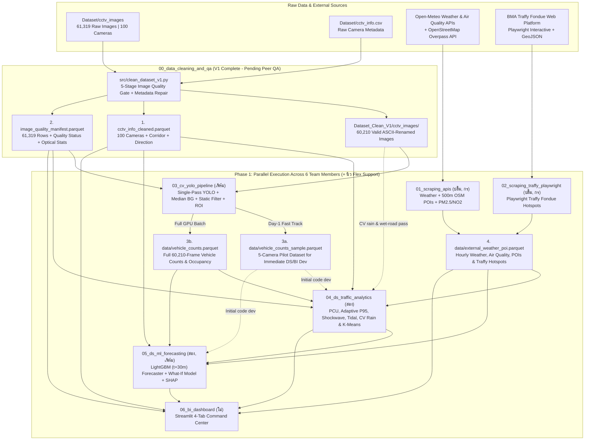

# Master Project Charter & Execution Roadmap (`GOAL.md`)

> **Project Title:** BKK-Pulse -- Spatio-Temporal Traffic Dynamics, Weather Vulnerability & CCTV Network Health Analytics  
> **Course:** 2110403 Data Science and Data Engineering (DSDE-CEDT)  
> **Team Size:** 6 Members *(Parallel Modular Workflow)*

---

## 1. Project Objectives

1. **Infrastructure Data Quality & Reliability Auditing:** Automatically detect, classify, and filter hardware/network failure modes across 100 BMA CCTV streams (`61,319` raw images) while diagnosing systemic network outages and camera maintenance priorities.
2. **Urban Context Enrichment via Web Scraping:** Augment visual traffic observations with meteorological records, city-wide air quality context (`PM2.5`, `NO2`, `CO`), surrounding 500m land-use Points of Interest (POIs), and citizen-reported monsoon complaints from Traffy Fondue.
3. **Physics-Informed Computer Vision & Traffic Engineering:** Overcome low-resolution (`352 x 288` px; `348 x 261` px on Cam `395`), low-light headlight glare, wet-road reflections, and static roadside false positives (e.g., motorcycle advertisement billboards) to derive standardized **Passenger Car Units (PCU)**, **Adaptive Composite Spatial Density**, and **Per-Camera P95 Normalized Congestion Scores (0-100)**.
4. **Advanced Analytics, CV Weather Sensing & Predictive Modeling:** Detect camera-level active rainfall and wet-road conditions directly from CCTV imagery via image processing, quantify corridor shockwaves, analyze directional tidal imbalances for reversible-lane policy design, rank rainfall impact and recovery durations, cluster road archetypes (K-Means + PCA), and predict 30-minute ahead congestion (LightGBM + SHAP + interactive What-If simulator).
5. **Interactive Decision-Support Dashboard:** Deliver an intuitive 4-tab Streamlit command center enabling city planners and network engineers to inspect traffic dynamics, simulate weather impacts, receive 30-minute gridlock alerts, and export actionable maintenance/policy schedules.

---

## 2. Course Grading Rubric Alignment (2110403 DSDE -- 15% Total Weight)

| Course Requirement | BKK-Pulse Implementation | Responsible Modules |
| :--- | :--- | :--- |
| **Required Task: Web Scraping** *(>= 3 Simple APIs OR >= 1 Interactive Website)* | **3 Simple APIs:** Open-Meteo Weather, OpenStreetMap Overpass POIs, Open-Meteo Air Quality; **Interactive Scraping:** Automated Playwright scraper + GeoJSON backfill for BMA Traffy Fondue monsoon hotspots | [`01_scraping_apis`](01_scraping_apis/GOAL.md), [`02_scraping_traffy_playwright`](02_scraping_traffy_playwright/GOAL.md) |
| **Component 1: Data Engineering (DE)** *(Cleansing, Preparation, Workflow Management)* | 5-Stage Automated Image Quality Gate; bilingual metadata repair (`district`, `corridor`, `direction`); single-pass batch YOLO inference, Median Background extraction, Stationary Box Filter (`IoU > 0.65`), Auto Road ROI (`15%` floor), Parquet/DuckDB schema & CLI orchestrator | [`run_pipeline.py`](run_pipeline.py), [`00_data_cleaning_and_qa`](00_data_cleaning_and_qa/GOAL.md), [`03_cv_yolo_pipeline`](03_cv_yolo_pipeline/GOAL.md) |
| **Component 2: Data Science (DS)** *(Analytics, Unsupervised & Supervised ML)* | PCU & adaptive Day/Night P95 Congestion Index; CCTV image-processing rain & wet-road detection (`visual_rain_flag`, `wet_road_flag`, `rain_severity_score`); Corridor Shockwaves, Tidal Flow & Rain Recovery; K-Means (`k=4`) + PCA clustering; LightGBM `t + 30m` forecasting vs. Naive baseline + SHAP | [`04_ds_traffic_analytics`](04_ds_traffic_analytics/GOAL.md), [`05_ds_ml_forecasting`](05_ds_ml_forecasting/GOAL.md) |
| **Component 3: BI Dashboard** *(Interactive Visualization & Decision Support)* | **4-Tab Streamlit Command Center:** Map + 30-Min Early Warning & Camera Inspector (Tab 1); Corridor Shockwaves, Tidal Flow & K-Means Archetypes (Tab 2); CV Weather Vulnerability, Interactive What-If Simulator & SHAP (Tab 3); BMA CCTV Network Health Audit (Tab 4) | [`06_bi_dashboard`](06_bi_dashboard/GOAL.md) |
| **Component 4: Actionable Insights** *(Policy & Engineering Recommendations)* | Exportable **Reversible Lane** time windows (`.csv`); **Top 10 rain-vulnerable bottlenecks** combining CV rain/wet-road detection & Traffy flood hotspots; proactive 30-minute gridlock warnings; priority maintenance dispatch tickets (`.csv`) for faulty CCTV cameras and IP subnets | All Modules (`00`-`06`) |
| **Part 2: Submission Package (5%)** *(Due Sun 6 Dec 2026)* | 15-minute YouTube presentation video (data sources, architecture diagram, live dashboard & What-If demo); source code & PDF slides in shared Google Drive (`viewer` access on MyCourseVille); Discord `#project-showroom` post | All 6 Team Members |

---

## 3. End-to-End Architecture & Data Flow

---

## 4. Phased Execution Strategy (Zero-Bottleneck Workflow)

To prevent downstream Data Science (`04`, `05`) and BI Dashboard (`06`) members from waiting on full Computer Vision inference across all 60,210 images, the project executes in three structured phases:

### Phase 0: Baseline Cleaning Verification & 5-Camera Pilot Generation
1. **Baseline Cleaning V1 (Completed):** [`00_data_cleaning_and_qa/src/clean_dataset_v1.py`](00_data_cleaning_and_qa/src/clean_dataset_v1.py) has already processed all 61,319 images and generated [`Dataset_Clean_V1/`](Dataset_Clean_V1/README.md).
2. **Distributed Image & Metadata QA (All 6 Members):** Each member (**ปลื้ม**, **กร**, **เฟิร์ม**, **สอง**, **นิว**, **โม่**) quickly scans through **all images** in `Dataset_Clean_V1/cctv_images/<cam_id>/` (to catch any severely broken/corrupted frames missed by the automated gates) and verifies `location_en`, `location_th`, `district`, `corridor`, `pair_id`, and `direction` for their assigned 16-17 cameras in [`00_data_cleaning_and_qa/CAMERA_AUDIT_CHECKLIST.md`](00_data_cleaning_and_qa/CAMERA_AUDIT_CHECKLIST.md). All edits go through personal GitHub branches + PRs into `main` (Google Drive is read-only; the maintainer runs the final rebuild and Drive sync once after all PRs are merged).
3. **5-Camera Pilot Dataset (เฟิร์ม `@nontaphatfirm` -- Priority 1):** Runs the YOLO + ROI pipeline on 5 representative cameras (`26`, `136`, `137`, `150`, `546` -- ~3,000 frames) and exports `data/vehicle_counts_sample.parquet` conforming to [`DATA_CONTRACT.md`](DATA_CONTRACT.md). This immediately unblocks **สอง**, **โม่**, and **นิว**.

### Phase 1: Parallel Track Development
- **ปลื้ม (`@siravidthongsook`) & กร (`@kkooAAA`) (`01_scraping_apis` & `02_scraping_traffy_playwright`):** Build and merge `data/weather_air_poi.parquet`, `data/traffy_complaints_near_cctv.parquet`, and `data/external_weather_poi.parquet`.
- **เฟิร์ม (`@nontaphatfirm`) (`03_cv_yolo_pipeline`):** Executes single-pass batch inference across all 60,210 valid images to produce `data/vehicle_counts.parquet` and `data/median_backgrounds/`.
- **สอง (`@theme222`) & เฟิร์ม (`@nontaphatfirm`) (`04_ds_traffic_analytics` & `05_ds_ml_forecasting`):** **สอง** leads analytical, CV rain/wet-road detection, and K-Means pipelines (`04`), and co-develops the LightGBM `t + 30m` forecasting & SHAP pipeline (`05`) with **เฟิร์ม** against `vehicle_counts_sample.parquet`, then swaps in full `vehicle_counts.parquet` once complete.
- **โม่ (`@moaqilo`) (`06_bi_dashboard`):** Immediately builds **Tab 4 (BMA CCTV Network Health Audit)** and the **Tab 1 Base Map** using [`Dataset_Clean_V1/cctv_info_cleaned.parquet`](Dataset_Clean_V1/cctv_info_cleaned.parquet) and [`Dataset_Clean_V1/image_quality_manifest.parquet`](Dataset_Clean_V1/image_quality_manifest.parquet), then integrates analytical outputs from `01`-`05`.
- **นิว (`@Pranithi-New`) (Cross-Module Support):** Flexibly joins any priority module (`01`-`06`) to accelerate implementation, integration, and QA.

### Phase 2: System Integration & Final Presentation (By Sun 6 Dec 2026)
- Run `python run_pipeline.py --check-contract --strict` to verify all Parquet schemas against [`DATA_CONTRACT.md`](DATA_CONTRACT.md).
- Perform end-to-end QA on the 4-tab Streamlit dashboard (including CSV exports & What-If Simulator).
- Record the **15-minute YouTube presentation video**, prepare PDF slides, upload to Google Drive (`viewer` access), submit via MyCourseVille, and post in Discord `#project-showroom`.

---

## 5. Team Kickoff Checklist

- [ ] **1. Project Walkthrough:** Review [`README.md`](README.md), [`Info/EDA.md`](Info/EDA.md), and [`Info/2110403_2026s1_Project_CEDT.pdf`](Info/2110403_2026s1_Project_CEDT.pdf).
- [ ] **2. Phase 0 Cleaning Review:** Inspect [`Dataset_Clean_V1/README.md`](Dataset_Clean_V1/README.md) and complete the 6 batches in [`00_data_cleaning_and_qa/CAMERA_AUDIT_CHECKLIST.md`](00_data_cleaning_and_qa/CAMERA_AUDIT_CHECKLIST.md).
- [ ] **3. Role Assignment (`01`-`06`):** Each member opens their respective `0X_<module_name>/GOAL.md` specification and creates their feature branch per [`CONTRIBUTING.md`](CONTRIBUTING.md).
- [ ] **4. Data Contract Sign-Off:** Review [`DATA_CONTRACT.md`](DATA_CONTRACT.md) primary keys (`cam_id`, `timestamp`), column names, and edge cases.
- [ ] **5. Milestones:**
  - **Milestone 1 (Sun 15 Nov 2026):** MCV group registration + Phase 0 Camera Audit Checklist + `data/vehicle_counts_sample.parquet`.
  - **Milestone 2:** Deliver full `data/external_weather_poi.parquet` (Tasks 01 & 02) and `data/vehicle_counts.parquet` (Task 03).
  - **Milestone 3 (Before Sun 6 Dec 2026):** Deliver analytical & CV weather tables (Task 04), LightGBM + What-If model + SHAP (Task 05), integrated 4-tab Streamlit dashboard (Task 06), and 15-min presentation package.
