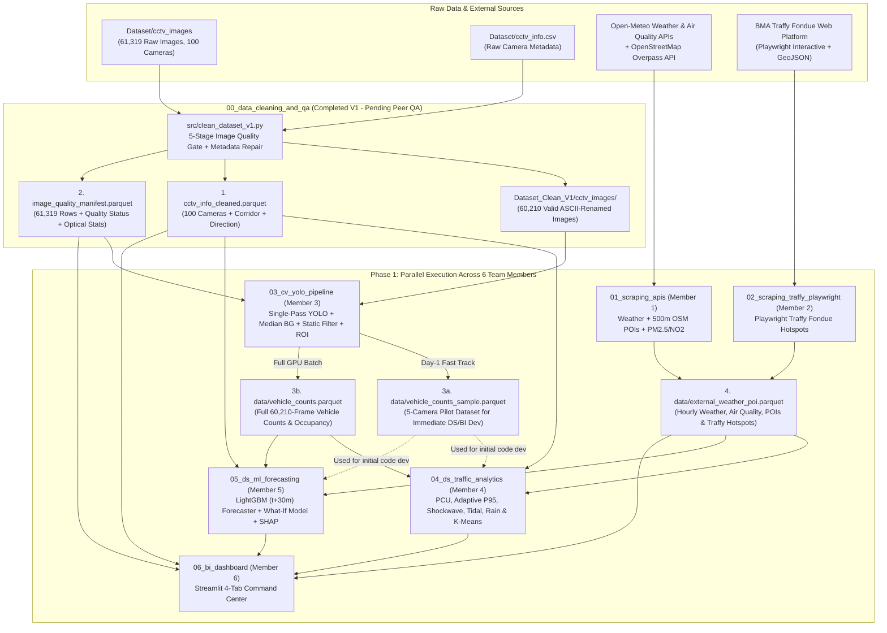

# Master Project Charter & Execution Roadmap (`GOAL.md`)

> **Project Title:** BKK-Pulse — Spatio-Temporal Traffic Dynamics, Weather Vulnerability & CCTV Network Health Analytics  
> **Course:** 2110403 Data Science and Data Engineering (DSDE-CEDT)  
> **Team Size:** 6 Members (Parallel Modular Workflow)

---

## 1. Project Objectives

1. **Infrastructure Data Quality & Reliability Auditing:** Automatically detect, classify, and filter hardware/network failure modes across 100 BMA CCTV streams (`61,319` raw images) while diagnosing systemic network outages and camera maintenance priorities.
2. **Urban Context Enrichment via Web Scraping:** Augment visual traffic observations with meteorological records, city-wide air quality context (`PM2.5`, `NO2`, `CO`), surrounding 500m land-use Points of Interest (POIs), and citizen-reported monsoon complaints from Traffy Fondue.
3. **Physics-Informed Computer Vision & Traffic Engineering:** Overcome low-resolution (`352×288` px; `348×261` px on Cam `395`), low-light headlight glare, wet-road reflections, and static roadside false positives (e.g., motorcycle advertisement billboards) to derive standardized **Passenger Car Units (PCU)**, **Adaptive Composite Spatial Density**, and **Per-Camera P95 Normalized Congestion Scores (`0–100`)**.
4. **Advanced Analytics & Predictive Modeling:** Quantify corridor shockwaves, directional tidal imbalances for reversible-lane policy design, rainfall impact and recovery durations, unsupervised road archetypes (K-Means + PCA), and 30-minute ahead congestion forecasts (LightGBM + SHAP + interactive What-If simulator).
5. **Interactive Decision-Support Dashboard:** Deliver an intuitive 4-tab Streamlit command center enabling city planners and network engineers to inspect traffic dynamics, simulate weather impacts, receive 30-minute gridlock alerts, and export actionable maintenance/policy schedules.

---

## 2. Course Grading Rubric Alignment (2110403 DSDE — 15% Total Weight)

| Course Requirement | BKK-Pulse Implementation | Responsible Modules |
| :--- | :--- | :--- |
| **Required Task: Web Scraping** *(≥ 3 Simple APIs OR ≥ 1 Interactive Website)* | Fulfilled via **both** criteria: • **3 Simple APIs:** Open-Meteo Historical Weather API + OpenStreetMap Overpass API + Open-Meteo Air Quality API • **Interactive Scraping:** Automated **Playwright** browser scraper + GeoJSON backfill for BMA Traffy Fondue flood, signal, and road obstruction hotspots | [`01_scraping_apis`](01_scraping_apis/GOAL.md) · [`02_scraping_traffy_playwright`](02_scraping_traffy_playwright/GOAL.md) |
| **Component 1: Data Engineering (DE)** *(Cleansing, Preparation, Workflow Management)* | 1. **5-Stage Automated Image Quality Gate** (`white_error`, `no_signal_error`, `corrupt_color`, `frozen`, filename timestamp enforcement) 2. **Metadata Cleansing & Spatial Enrichment** (coordinate-verified English/Thai names, `district`, `corridor`, `pair_id`, `direction`) 3. **CV Feature Extraction Pipeline:** Single-pass batch YOLO inference, Median Background extraction, Stationary Box Filter (`IoU > 0.65`), Auto Road ROI (`15%` floor), Parquet/DuckDB storage 4. **End-to-End Workflow Management:** Unified CLI orchestrator & contract validator | [`run_pipeline.py`](run_pipeline.py) · [`00_data_cleaning_and_qa`](00_data_cleaning_and_qa/GOAL.md) · [`03_cv_yolo_pipeline`](03_cv_yolo_pipeline/GOAL.md) |
| **Component 2: Data Science (DS)** *(Analytics, Unsupervised & Supervised ML)* | 1. **Physics-Informed Metrics:** PCU, Adaptive Day vs. Night/Glare/Rain Composite Density, `low_visibility_flag`, `visual_rain_flag`, and P95 Congestion Index 2. **Spatio-Temporal & Event Analysis:** Corridor Space-Time Heatmaps, Inbound/Outbound Tidal Flow (80 cameras + 6 footbridge pairs), Rainfall Recovery Time analysis 3. **Unsupervised Learning:** K-Means Clustering (`k=4` archetypes) with PCA & Radar profiling 4. **Supervised ML:** 30-minute ahead LightGBM Regressor (`models/lgbm_congestion_forecaster.txt`) benchmarked against Naive Persistence with SHAP attribution & proactive alert tiers | [`04_ds_traffic_analytics`](04_ds_traffic_analytics/GOAL.md) · [`05_ds_ml_forecasting`](05_ds_ml_forecasting/GOAL.md) |
| **Component 3: BI Dashboard** *(Interactive Visualization & Decision Support)* | **4-Tab Streamlit Command Center:** • **Tab 1:** Bangkok Live Pulse Map, 30-Min Early Warning Alert Banner & Camera Inspector • **Tab 2:** Corridor Shockwave, Tidal Flow (CSV Reversible Lane export) & Road Archetypes • **Tab 3:** Weather Vulnerability, Interactive LightGBM **What-If Simulator** & SHAP • **Tab 4:** BMA CCTV Network Health Audit (CSV Maintenance Ticket export) | [`06_bi_dashboard`](06_bi_dashboard/GOAL.md) |
| **Component 4: Actionable Insights** *(Policy & Engineering Recommendations)* | Exportable recommendations for BMA Traffic & Transportation Department: (a) road segments and time windows for **Reversible Lanes**, (b) top 10 rain-vulnerable bottlenecks cross-referenced with Traffy Fondue monsoon hotspots, (c) proactive 30-minute gridlock warnings, and (d) priority maintenance dispatch list for faulty CCTV cameras and IP subnets | All Modules (`00`–`06`) |
| **Part 2: Submission Package (5%)** *(Due Sun 6 Dec 2026)* | 1. **15-Minute YouTube Presentation Video** (Data & scraping sources, component interconnection diagram, live dashboard & What-If demo) 2. **Source Code & PDF Slides** in shared Google Drive (`viewer` access on MyCourseVille) 3. **Discord `#project-showroom`** showcase post | All 6 Team Members |

---

## 3. End-to-End Architecture & Data Flow

---

## 4. Phased Execution Strategy (Zero-Bottleneck Workflow)

To prevent downstream Data Science (`04`, `05`) and BI Dashboard (`06`) members from waiting on full Computer Vision inference across all 60,210 images, the project executes in three structured phases:

### Phase 0: Baseline Cleaning Verification & 5-Camera Pilot Generation
1. **Baseline Cleaning V1 (Completed):** [`00_data_cleaning_and_qa/src/clean_dataset_v1.py`](00_data_cleaning_and_qa/src/clean_dataset_v1.py) has already processed all 61,319 images and generated [`Dataset_Clean_V1/`](Dataset_Clean_V1/README.md).
2. **Distributed Metadata QA (All 6 Members — ~20 mins/person):** Each member verifies their assigned 16–17 cameras in [`00_data_cleaning_and_qa/CAMERA_AUDIT_CHECKLIST.md`](00_data_cleaning_and_qa/CAMERA_AUDIT_CHECKLIST.md) to confirm `location_en`, `location_th`, `district`, `corridor`, `pair_id`, and `direction`.
3. **5-Camera Pilot Dataset (Member 3 — Priority 1):** Member 3 runs the YOLO + ROI pipeline on 5 representative cameras (`26`, `136`, `137`, `150`, `546` — ~3,000 frames) and exports `data/vehicle_counts_sample.parquet` conforming to [`DATA_CONTRACT.md`](DATA_CONTRACT.md). This immediately unblocks Members 4, 5, and 6.

### Phase 1: Parallel Track Development
- **Member 1 (`01_scraping_apis`)** and **Member 2 (`02_scraping_traffy_playwright`)** build and merge `data/external_weather_poi.parquet`.
- **Member 3 (`03_cv_yolo_pipeline`)** executes single-pass batch inference across all 60,210 valid images to produce `data/vehicle_counts.parquet` and `data/median_backgrounds/`.
- **Member 4 (`04_ds_traffic_analytics`)** and **Member 5 (`05_ds_ml_forecasting`)** develop their analytical and LightGBM pipelines against `vehicle_counts_sample.parquet`, then swap in `vehicle_counts.parquet` once complete.
- **Member 6 (`06_bi_dashboard`)** immediately builds **Tab 4 (BMA CCTV Network Health Audit)** and the **Tab 1 Base Map** using [`Dataset_Clean_V1/cctv_info_cleaned.parquet`](Dataset_Clean_V1/cctv_info_cleaned.parquet) and [`Dataset_Clean_V1/image_quality_manifest.parquet`](Dataset_Clean_V1/image_quality_manifest.parquet), then integrates analytical outputs from Members 1–5.

### Phase 2: System Integration & Final Presentation (By Sun 6 Dec 2026)
- Run `python run_pipeline.py --check-contract --strict` to verify all Parquet schemas against [`DATA_CONTRACT.md`](DATA_CONTRACT.md).
- Perform end-to-end QA on the 4-tab Streamlit dashboard (including CSV exports & What-If Simulator).
- Record the **15-minute YouTube presentation video**, prepare PDF slides, upload to Google Drive (`viewer` access), submit via MyCourseVille, and post in Discord `#project-showroom`.

---

## 5. Team Kickoff Checklist

- [ ] **1. Project Walkthrough:** Review [`README.md`](README.md), [`Info/EDA.md`](Info/EDA.md), and [`Info/2110403_2026s1_Project_CEDT.pdf`](Info/2110403_2026s1_Project_CEDT.pdf).
- [ ] **2. Phase 0 Cleaning Review:** Inspect [`Dataset_Clean_V1/README.md`](Dataset_Clean_V1/README.md) and complete the 6 batches in [`00_data_cleaning_and_qa/CAMERA_AUDIT_CHECKLIST.md`](00_data_cleaning_and_qa/CAMERA_AUDIT_CHECKLIST.md).
- [ ] **3. Role Assignment (`01`–`06`):** Each member opens their respective `0X_<module_name>/GOAL.md` specification and creates their feature branch per [`CONTRIBUTING.md`](CONTRIBUTING.md).
- [ ] **4. Data Contract Sign-Off:** Review [`DATA_CONTRACT.md`](DATA_CONTRACT.md) primary keys (`cam_id`, `timestamp`), column names, and edge cases.
- [ ] **5. Milestones:**
  - **Milestone 1 (Sun 15 Nov 2026):** MCV group registration + Phase 0 Camera Audit Checklist + `data/vehicle_counts_sample.parquet`.
  - **Milestone 2:** Deliver full `data/external_weather_poi.parquet` (Tasks 01 & 02) and `data/vehicle_counts.parquet` (Task 03).
  - **Milestone 3 (Before Sun 6 Dec 2026):** Deliver analytical tables (Task 04), LightGBM + What-If model + SHAP (Task 05), integrated 4-tab Streamlit dashboard (Task 06), and 15-min presentation package.
