# Exploratory Data Analysis (EDA) — Bangkok CCTV Image Dataset

เอกสารนี้รวบรวมผลการสำรวจข้อมูลเชิงลึก (EDA) จากตาราง Metadata (`Dataset/cctv_info.csv` จำนวน 100 กล้อง) และไฟล์ภาพกล้องวงจรปิดทั้งหมด (`Dataset/cctv_images/cctv_images/` จำนวน **61,319 ภาพ** เก็บข้อมูลตั้งแต่วันอังคารที่ **25 ส.ค. 2026** ถึงวันจันทร์ที่ **31 ส.ค. 2026** ช่วงเวลา **06:00 – 21:00 น.** ความถี่ประมาณทุก **10 นาที**)

---

## 1. ภาพรวมจำนวนข้อมูลและการกระจายตามเวลา (Temporal Coverage)

* **จำนวนภาพทั้งหมด:** 61,319 ภาพ จาก 100 กล้อง (เฉลี่ย 604 – 631 ภาพต่อกล้อง)
* **จำนวนภาพรายวัน:**
  * อังคาร 25 ส.ค. 2026: `8,937` ภาพ
  * พุธ 26 ส.ค. 2026: `8,953` ภาพ
  * **พฤหัสบดี 27 ส.ค. 2026: `7,438` ภาพ** *(ลดลงผิดปกติ ~1,500 ภาพในช่วงเช้า 06:00 – 08:50 น.)*
  * ศุกร์ 28 ส.ค. 2026: `9,015` ภาพ
  * เสาร์ 29 ส.ค. 2026: `8,964` ภาพ
  * อาทิตย์ 30 ส.ค. 2026: `9,002` ภาพ
  * จันทร์ 31 ส.ค. 2026: `9,010` ภาพ
* **ความละเอียดภาพ (Image Resolution):**
  * กล้อง **99 ตัว** มีความละเอียดมาตรฐาน CIF **`352 × 288` พิกเซล**
  * กล้อง **1 ตัว** คือ **Camera ID `395` (`แยกเสาชิงช้า`)** มีความละเอียด **`348 × 261` พิกเซล** *(ต้องระวังเวลาคำนวณสัดส่วนพื้นที่รถต่อพื้นที่ภาพ)*

---

## 2. ความผิดปกติของข้อมูลใน `cctv_info.csv` (Metadata Anomalies)

คอลัมน์ `location_en` และ `location_detail_en` มีค่า `NULL` (`NaN`), ค่า `'0'` ที่สื่อถึง `NULL`, รวมถึงข้อผิดพลาดจากการแปลและการสลับแถวข้อมูล ดังนี้:

### 2.1 ค่าว่าง (`NULL`) และ Placeholder ขยะ
* **ค่าว่าง (`NULL` / `NaN`):** กล้อง `1589` (`แยกแม้นศรี`) มีค่า `location_en` และ `location_detail_en` เป็น `NULL` ทั้งคู่ และกล้อง `572` มี `location_detail_en` เป็น `NULL`
* **ค่า `'0'` แทน `NULL`:** กล้อง `576` (`แยกบางลำพู`), `1368` (`แยกพาณิชยการ`), และ `546` (`แยกพาณิชยการ`) มีค่า `location_detail_en` เป็น `'0'`
* **ค่า `'connect BMAcctv'`:** กล้อง 4 ตัว ได้แก่ `915` (`วงเวียนใหญ่`), `939` (`แยกมหาดไทย`), `913` (`แยกเอส-เอ-บี`), และ `938` (`รามคำแหง-พระราม-9`) มีทั้ง `location_en` และ `location_detail_en` เป็นคำว่า `'connect BMAcctv'`
* **Artifacts จากการแปลภาษา (Google Translate UI):**
  * กล้อง `1103` (`แยกรัชดา-ราชพฤกษ์`): `location_en` มีคำว่า **`17/5000 Ratchada-Ratchaphruek Intersection`** (ติดเลขตัวนับจำนวนตัวอักษร `17/5000` จากหน้าเว็บ Google Translate)
  * กล้อง `556` (`แยกวชิระ`): `location_detail_en` มีข้อความหมายเหตุติดมาว่า **`From Krung Thon Bridge (See Yellow)`**

### 2.2 ชื่อสถานที่ภาษาอังกฤษ (`location_en`) ผิดสถานที่หรือสลับแถว (ข้ามเขตไกลถึง 15 กม.)
พบว่ามีหลายแถวที่ชื่อภาษาอังกฤษไม่ตรงกับชื่อภาษาไทยและไม่ตรงกับพิกัด `(latitude, longitude)` จริง:
* **กล้อง `529`** (ไทย: `จุดตัดถนนพุทธมณฑลสาย2-ฝั่งขา`, พิกัดตลิ่งชัน `13.78462, 100.39461`) แต่ `location_en` เขียนว่า **`Henri Dunant Intersection, From Sala Daeng Intersection`**
* **กล้อง `1188`** (ไทย: `จุดตัดถนนพุทธมณฑลสาย2-ฝั่งขา`, พิกัด `13.78288, 100.40926`) แต่ `location_en` เขียนว่า **`Ratchathewi Intersection`**
* **กล้อง `572`** (ไทย: `ทางคู่ขนานลอยฟ้า-บรมราชชนนี( ช่วงทางขึ้นตลิ่งชัน`, พิกัด `13.78583, 100.46178`) แต่ `location_en` เขียนว่า **`Jor Por Ror Intersection`**
* **กล้อง `126` และ `127`** (ไทย: `สะพานลอยซอยรัชดาภิเษก-30` บนถนนรัชดาภิเษก) แต่ `location_en` เขียนว่า **`Near Soi Lat Phrao 30 on Lat Phrao Road`**
* **กล้อง `432`** (`ทางแยกสามย่าน`) และ **กล้อง `619`** (`ทางแยกอังรีดูนังค์`) ถูกตั้งชื่อ `location_en` ซ้ำกันว่า **`Pathum Wan Intersection`**
* **กล้อง `500`** (`ทางแยกมิตรสัมพันธ์`) แต่ `location_en` เขียนว่า **`Pra Tu Num Intersection`**
* **กล้อง `1368`** (`แยกพาณิชยการ`) แต่ `location_en` เขียนว่า **`Lan Phra Rup Intersection`**

### 2.3 ชื่อภาษาไทย (`location`, `location_detail`) ถูกตัดคำที่ความยาว ~28 ตัวอักษร
มีกล้องถึง **53 ตัวจาก 100 ตัว** ที่ข้อความภาษาไทยในคอลัมน์ `location` หรือ `location_detail` ถูกตัดคำกลางคัน (เนื่องจากข้อจำกัดความยาวฟิลด์ตอนเก็บข้อมูล) เช่น:
* `สะพานลอยใกล้บิ๊กซีเอ็กซ์ตร` (ขาดคำว่า *า ลาดพร้าว*)
* `รถมาจากแยกรัชดา-ลาดพร้าว-มุ่` (ขาดคำว่า *งหน้า...*)
* `ทางคู่ขนานลอยฟ้า-บรมราชชนนี(` (วงเล็บเปิดค้างไว้)

### 2.4 โครงสร้างเชิงพื้นที่และเครือข่าย: คู่กล้องระยะใกล้ (≤ 100 m) 21 คู่ (เป็นคู่สะพานลอยหันสวนทางจริง 6 คู่) และ 18 IP Subnets
* **จากการคำนวณระยะห่างพิกัด พบคู่กล้องที่อยู่ห่างกันไม่เกิน 100 เมตร จำนวน 21 คู่** แต่เมื่อตรวจสอบด้วยภาพจริงทั้งกลางวันและกลางคืน (`19:00` น. ดูทิศไฟหน้า-ไฟท้ายรถ) พบว่าแบ่งออกเป็น:
  1. **คู่กล้องบนสะพานลอยเดียวกันที่หันส่องคนละฝั่งถนนอย่างแท้จริง (True Footbridge Bidirectional Pairs — 6 คู่ / 12 กล้อง):**
     * คู่กล้อง `1132` & `1078` (สะพานลอยหน้าวัดสุวรรณ ถ.เจริญนคร — ห่างกัน `13.0 m`)
     * คู่กล้อง `136` & `137` (สะพานลอยใกล้ Big C Extra ถ.ลาดพร้าว — ห่างกัน `15.7 m`)
     * คู่กล้อง `178` & `179` (สะพานลอยหน้า รพ.พญาไท 2 ถ.พหลโยธิน — ห่างกัน `17.3 m`)
     * คู่กล้อง `126` & `127` (สะพานลอยซอยรัชดาภิเษก 30 — ห่างกัน `18.5 m`)
     * คู่กล้อง `224` & `225` (สะพานลอยใกล้ศาลอาญา ถ.รัชดาภิเษก — ห่างกัน `21.6 m`)
     * คู่กล้อง `176` & `177` (สะพานลอยหน้าสวนจตุจักร ถ.พหลโยธิน — ห่างกัน `35.7 m`)
  2. **คู่กล้องที่หันคนละทิศบนถนนที่ไม่มีเกาะกลาง (เห็นรถวิ่งทั้ง 2 ฝั่งในภาพเดียว — 2 คู่):** คู่กล้อง `233` & `1063` (ตรงข้ามพระตำหนักจิตรลดาฯ ถ.พระรามที่ 5 — `4.7 m`) และคู่กล้อง `1361` & `70` (หน้า ธปท. ถ.สามเสน — `10.9 m`)
  3. **คู่กล้องฝั่งตรงข้ามของสี่แยกเดียวกันบนถนนเส้นเดียวกัน (แต่ระยะซูมต่างกัน — 2 คู่):** คู่กล้อง `123` & `125` (แยกรัชดา-ลาดพร้าว ด้าน ถ.รัชดาฯ — `16.3 m`) และคู่กล้อง `118` & `120` (แยกรัชดา-สุทธิสาร ด้าน ถ.สุทธิสารฯ — `51.2 m`)
  4. **คู่กล้องสี่แยกที่หันตั้งฉากกัน (คนละสายถนน), มองเข้าแยกเหมือนกัน, หรือถ่ายมุมเดียวกันซ้อนทับกัน (11 คู่):** เช่น คู่นับซ้ำจากแยกที่มีกล้อง 3 ตัว (`124` ตั้งฉากกับ `123`/`125` และ `119` ตั้งฉากกับ `118`/`120`), แยกพาณิชยการ (`1368`/`546` คนละสายถนน), แยกสะพานแดง (`18`/`1028` มุมซ้อนทับกัน), และแยกเทเวศร์ (`370`/`371` มุมซ้อนทับกัน)
* **วงแลน IP Address (`ip_address`):** แบ่งออกเป็น 18 Subnets (ตาม 2 Octet แรก เช่น `10.117.x.x` 17 กล้อง, `10.102.x.x` 14 กล้อง, `10.101.x.x` 11 กล้อง, `10.116.x.x` 7 กล้อง) ซึ่งสัมพันธ์กับเซิร์ฟเวอร์สตรีมมิ่งและอาการภาพค้างพร้อมกันเป็นกลุ่ม

---

## 3. ความผิดปกติของไฟล์ภาพและสัญญาณวิดีโอ (Image & Stream Anomalies)

จากการตรวจสอบไฟล์ภาพทั้งหมด **61,319 ภาพ** พบภาพที่มีปัญหาคุณภาพสัญญาณรวมกว่า **1,112 ภาพ** แบ่งออกเป็น 5 ประเภทหลัก:

| ประเภทภาพผิดปกติ | จำนวนที่พบ | ลักษณะทางสถิติ / เงื่อนไขสำหรับคัดกรอง (Filter Rule) |
| :--- | :---: | :--- |
| **1. ภาพขาวล้วน (Blank White Error Frames)** | **504 ภาพ** | ขนาดไฟล์ `1,402 – 1,403 bytes`, ค่าเฉลี่ยพิกเซล `mean == 255.0`, `std == 0.0` |
| **2. ภาพ Rainbow No Signal (`gst-launch-0.10`)** | **33 ภาพ** | ขนาดไฟล์ `8,782 bytes`, `mean == 128.07`, `std == 112.20` (พบในกล้อง `432` และ `1804`) |
| **3. ภาพค้างซ้ำเดิม 100% (Frozen Camera Streams)** | **568 ภาพ** | ภาพต่อเนื่องกันมีค่า `Mean Absolute Difference (MAD) == 0.0` (พิกเซลเหมือนกัน 100% ทุกจุด) |
| **4. ภาพเสียสีเทา (H.264 Gray P-Frame Corruption)** | **6 ภาพ** | ค่าเฉลี่ยพิกเซล `127 <= mean <= 132` และความเปรียบต่างต่ำมาก (`std < 16`) จากการที่ I-Frame หาย |
| **5. ภาพเสียสีเขียวทั้งจอ (Green Screen YUV Corruption)** | **1 ภาพ** | ค่าสีเขียวพุ่งสูงผิดปกติ (`G = 127.8` ขณะที่ `R = 2.0, B = 2.7`) ที่กล้อง `32` |

### 3.1 ภาพเสียสีขาวล้วน (504 ภาพ) — กระจุกตัวช่วงเช้า 07:15 – 08:45 น.
จากภาพทั้งหมด 61,319 ภาพ มี **504 ภาพ** ที่เป็นภาพสีขาวล้วน (`size = 1,403 bytes`) โดยเกิดขึ้นเฉพาะช่วงเวลา **07:15 – 08:45 น.** ของทุกวัน:
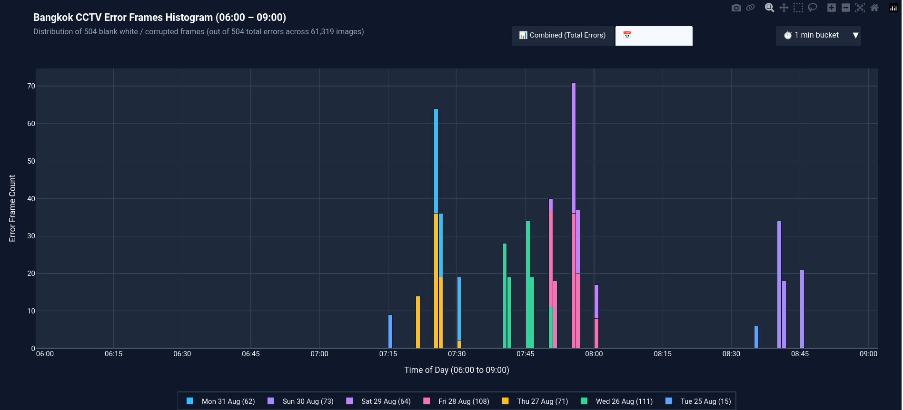

### 3.2 ภาพ Rainbow No Signal (`gst-launch-0.10`) (33 ภาพ) — กล้อง `432` และ `1804`
ในเช้าวันที่ **27 ส.ค. 2026 ช่วงเวลา 06:00 – 08:45 น.** เฉพาะกล้องหมายเลข `432` (`ทางแยกสามย่าน`) และ `1804` (`ปากซอยอ่อนนุช 33`) แสดงภาพแถบสีทดสอบสัญญาณ (`gst-launch-0.10` test pattern) รวม **33 ภาพ**:
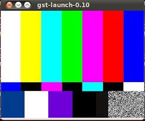

### 3.3 จำนวนภาพหายไปอย่างมีนัยสำคัญในเช้าวันที่ 27 ส.ค. 2026 (06:00 – 08:50 น.) และปริศนากล้อง `150`
ในวันที่ **27 ส.ค. 2026 ช่วงเวลา 06:00 – 08:50 น.** ระบบเก็บภาพล่มเกือบทั้งหมด ทำให้กล้อง 97 ตัวไม่มีภาพในช่วงเวลานี้ (ยกเว้นช่วงสั้นๆ ที่ได้ภาพขาว):
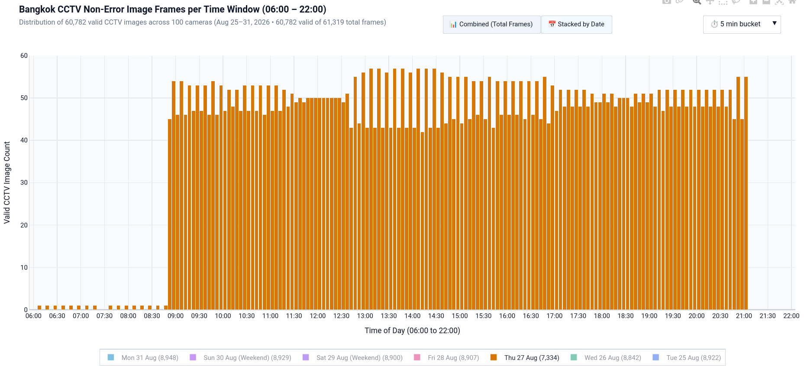

* **ข้อค้นพบใหม่ (เฉลยทำไมยังมีแท่งกราฟ 1 แท่งโผล่ในเช้าวันที่ 27 ส.ค.):**
  * เมื่อตรวจสอบว่าทำไมในกราฟ `image-2.png` ช่วงเวลา `06:00 – 08:50 น.` ของวันที่ 27 ส.ค. จึงยังมีภาพที่ "ไม่ใช่ภาพขาวและไม่ใช่ Rainbow" เหลืออยู่ **1 ภาพในทุกๆ ช่วงเวลา** พบว่าภาพเหล่านั้นมาจาก **กล้อง `150` (`สะพานลอยใกล้-โรงเรียนสามเสน`) เพียงตัวเดียว** (ซึ่งมีจำนวนภาพรวมสูงสุดในชุดข้อมูลคือ `631` ภาพ)
  * แต่เมื่อเปิดดูภาพของกล้อง `150` ในเช้าวันที่ 27 ส.ค. (`06:06 – 08:46 น.`) พบว่า **เป็นภาพค้าง (Frozen Frame) ที่ค้างมาตั้งแต่คืนวันที่ 26 ส.ค. เวลา `19:41:12`!** กล่าวคือ ไม่มีกล้องตัวใดเลยที่ได้ภาพการจราจรจริงในช่วง 06:00 – 08:50 น. ของวันที่ 27 ส.ค.

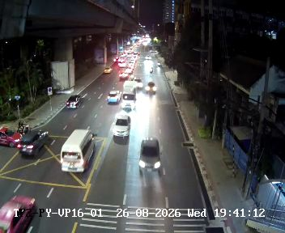

### 3.4 ปัญหาภาพค้าง (Frozen Camera Streams — 568 ภาพ)
พบปรากฏการณ์ที่สตรีมของกล้องค้าง ทำให้ได้ภาพที่มีพิกเซลเหมือนกัน 100% (`MAD == 0.0`) ต่อเนื่องกันหลายช่วงเวลา (แม้บางไฟล์จะมีค่า Byte/MD5 ต่างกันเล็กน้อยในระดับ Header):
* **กล้องที่มีภาพค้างสะสมมากที่สุด:**
  1. **กล้อง `150`** (`สะพานลอยใกล้-โรงเรียนสามเสน`): ค้างสะสม **124 เฟรม**
  2. **กล้อง `938`** (`TF-KP-03-รามคำแหง-พระราม-9`): ค้างสะสม **98 เฟรม**
  3. **กล้อง `206`** (`สะพานลอยใกล้ซอยนราธิวาสราช`): ค้างสะสม **95 เฟรม** (เช่น ค้างติดต่อกันกว่า 2 ชั่วโมงในวันที่ 29 ส.ค.)
  4. **กล้อง `939`** (`TF-KP-04-แยกมหาดไทย`): ค้างสะสม **95 เฟรม**
  5. **กล้อง `395`** (`แยกเสาชิงช้า`): ค้างสะสม **72 เฟรม**
  6. **กล้อง `1804`** (`ปากซอยอ่อนนุช 33`): ค้างสะสม **19 เฟรม**
* **อาการค้างพร้อมกันตามวงแลน (Synchronized Subnet Freeze):** เช่น วันที่ 28 ส.ค. เวลา `13:06 – 13:35 น.` กล้องในวง `10.116.x.x` (`1103`, `32`, `26`) ภาพค้างพร้อมกันทั้งหมด
* **ความสำคัญต่อการทำ Data Engineering:** ต้องทำ **Frozen Frame Deduplication** ก่อนนำผลตรวจจับรถไปคำนวณค่าสถิติ มิฉะนั้นจะเกิดการนับรถคันเดิมซ้ำหลายสิบครั้ง

### 3.5 ภาพเสียจากระบบบีบอัดวิดีโอ H.264 Gray P-Frame (6 ภาพ) และ Green Screen (1 ภาพ)
* **Gray P-Frame Ghosting (กล้อง `169` จำนวน 5 ภาพ และกล้อง `206` จำนวน 1 ภาพ):** เกิดจากการที่เฟรมหลัก (I-Frame / Keyframe) สูญหายระหว่างการส่งข้อมูลผ่านเครือข่าย เหลือเพียงข้อมูลการเคลื่อนที่ (P-Frame) บนพื้นหลังสีเทา (`mean ≈ 130, std < 15`)
* **Green Screen (กล้อง `32` วันที่ 26 ส.ค. เวลา `10:55:47`):** ภาพสูญเสียข้อมูลช่องสี YUV จนกลายเป็นสีเขียวทั้งภาพ

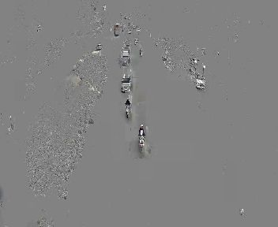
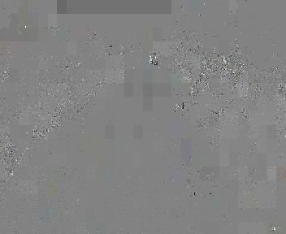
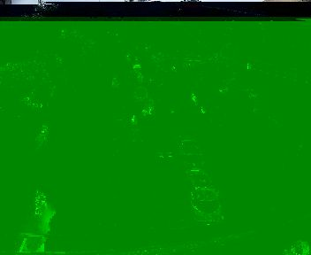

---

## 4. ความท้าทายด้านสภาพแวดล้อมและการตรวจจับวัตถุ (Environmental & CV Challenges)

### 4.1 แสงน้อยและแสงฟุ้งจากไฟหน้ารถตอนกลางคืน (Low-Light & Headlight Bloom) + ป้ายโฆษณาข้างทาง (Billboard False Positives)
* ในช่วงเวลากลางคืน แสงไฟหน้ารถที่ส่องเข้าหากล้องโดยตรงทำให้เกิดแสงฟุ้งจ้า (High Bloom/Glare) จนโมเดลตรวจจับวัตถุทั่วไป (เช่น YOLO) ไม่สามารถตรวจจับรถยนต์ที่อยู่ในกลุ่มแสงฟุ้งได้
* นอกจากนี้ ในภาพตัวอย่างด้านขวา (`image-4.png`) จะเห็นว่าบนเสาตอม่อ BTS ด้านซ้ายมี **ป้ายโฆษณารถมอเตอร์ไซค์ (ZONTES)** และมีรถจอดนิ่งอยู่ริมทาง ซึ่งโมเดล YOLO มีโอกาสตรวจจับผิดพลาดซ้ำๆ ในทุกเฟรม จึงควรสร้าง **Active Road ROI Mask** และตัวกรอง **Stationary Bounding Box Suppression** (ตัด Bounding Box ที่อยู่นิ่งที่พิกัดเดิมตลอดทั้งวันออก)

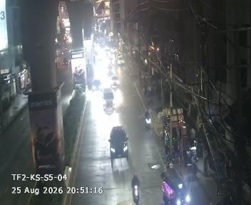
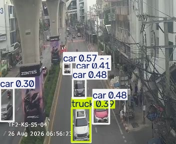

### 4.2 ฝนตกหนักและหมอกบังหน้ากล้อง (Heavy Rain / Low Visibility)
* ในช่วงที่มีพายุฝนตกหนัก เช่น วันที่ **30 ส.ค. 2026 เวลา 16:05 น.** ที่กล้อง `529` (`พุทธมณฑลสาย 2`) ม่านฝนทำให้ความเปรียบต่างของภาพลดลงอย่างมาก (`std ≈ 25.0`) และพื้นถนนเปียกสะท้อนแสงไฟ
* เราสามารถใช้ค่าความเปรียบต่างของภาพ (`Image Contrast / std`) และความคมชัด (`Laplacian Variance`) เทียบกับภาพพื้นหลังปกติของกล้องตัวนั้น เพื่อสร้างดัชนี **"Visual Rain & Fog Severity Index"** จากภาพได้โดยตรง

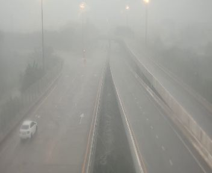

### 4.3 วันที่และเวลาที่ฝังอยู่ในภาพ (OSD Timestamp) ผิดพลาดจากการรีเซ็ตระบบไฟ
* วันที่และเวลาที่พิมพ์ทับอยู่บนมุมภาพ (On-Screen Display — OSD) มักรีเซ็ตกลับไปเป็นปี **`1970`** (Unix Epoch Reset เช่น `04 Feb 1970`) เมื่อเกิดไฟดับหรือกล้องรีบูต รวมถึงกรณีภาพค้างที่เวลาบนภาพหยุดเดินแต่ชื่อไฟล์ยังเปลี่ยนตามเวลาที่ Scraper ดึงข้อมูล
* **แนวปฏิบัติที่ถูกต้อง:** ต้องดึง Timestamp จาก **ชื่อไฟล์ (`YYYYMMDD_HHMMSS.jpg`)** เสมอ และตรวจสอบควบคู่กับระบบคัดกรองภาพค้าง (Frozen Frame Detection)

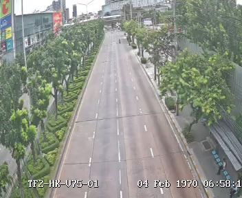
