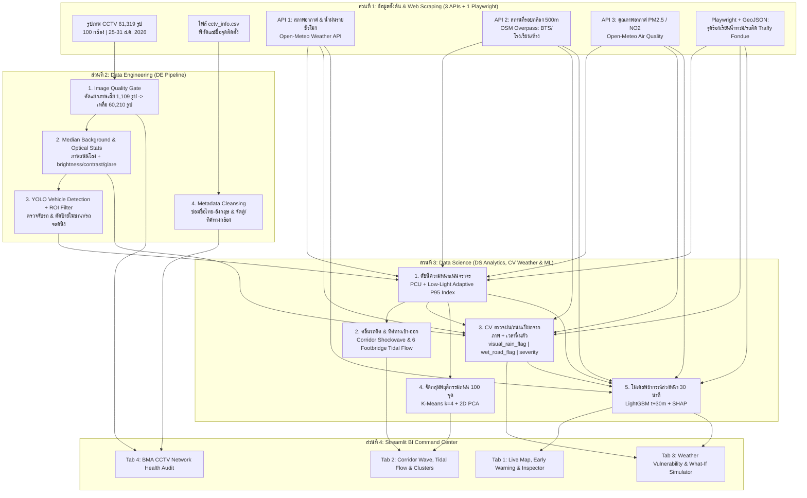

# Project Ideas & Blueprint -- Bangkok CCTV Image Analysis (2110403 DSDE)

เอกสารนี้สรุปไอเดียโครงงาน **Data Science & Data Engineering** แบบเข้าใจง่าย โดยออกแบบให้ตอบโจทย์เกณฑ์การให้คะแนนทั้ง 15% ของวิชาอย่างครบถ้วน และแก้ปัญหาข้อมูลจริงที่เราค้นพบใน [EDA.md](./EDA.md) ได้ตรงจุด

---

## 1. ภาพรวมโจทย์และสิ่งที่โปรเจกต์ต้องมี (Checklist กันพลาด)

ตามเกณฑ์ของวิชา โปรเจกต์ของเราต้องเปลี่ยน **"รูปภาพกล้องวงจรปิด กทม. ดิบ 61,319 รูป (100 กล้อง)"** ให้กลายเป็น **"ข้อมูลตาราง (Structured Data)"** เพื่อนำไปวิเคราะห์และสร้าง Dashboard โดยมี **5 ส่วนบังคับ** ดังนี้:

1. **Web Scraping (งานบังคับแยกต่างหาก ไม่นับรวมใน DE):**
   - ต้องดึงข้อมูลเพิ่มจากเว็บทั่วไป/API **อย่างน้อย 3 แหล่ง** *หรือ* ดึงจากเว็บแบบ Interactive (ใช้ Playwright / Selenium) **อย่างน้อย 1 แหล่ง**
2. **Component 1: Data Engineering (DE):**
   - ทำความสะอาดข้อมูล (Data Cleansing) + เตรียมข้อมูล (Data Preparation) + จัดการ Pipeline (Workflow Management) ให้รันได้ตั้งแต่ต้นจนจบ
3. **Component 2: Data Science (DS):**
   - ใช้สถิติ, Machine Learning, หรือการวิเคราะห์เชิงลึกเพื่อหา Pattern ตามช่วงเวลา (Temporal) และสถานที่ (Spatial)
4. **Component 3: BI Dashboard:**
   - หน้าเว็บหรือกระดานสรุปผลที่กดเลือกดูข้อมูล กราฟ และแผนที่ได้ง่าย
5. **Component 4: Insights (ผลลัพธ์และข้อค้นพบ):**
   - สรุปสิ่งที่ค้นพบจากข้อมูลว่าเอาไปใช้แก้ปัญหาจราจรหรือระบบกล้องของ กทม. ได้อย่างไร

---

## 2. ธีมหลักของโปรเจกต์ (Recommended Flagship Idea)

> **ชื่อโปรเจกต์:**  
> **"BKK-Pulse: ระบบวิเคราะห์พลวัตการจราจร ความเปราะบางต่อสภาพอากาศ และตรวจสอบสุขภาพเครือข่ายกล้อง CCTV กรุงเทพมหานคร"**  
> *(Smart Spatio-Temporal Traffic Dynamics, Weather Vulnerability & CCTV Network Health Analytics)*

### ทำไมไอเดียนี้ถึงโดดเด่นและตอบโจทย์?

- **กลุ่มทั่วไปมักทำแค่:** เอารูปเข้าโมเดล YOLO -> นับจำนวนรถ -> พล็อตกราฟว่ากี่โมงรถเยอะที่สุด (ซึ่งได้ผลลัพธ์ตื้นและโดนหลอกด้วยข้อมูลเสีย เช่น ภาพค้าง หรือป้ายโฆษณาข้างทาง)
- **สิ่งที่โปรเจกต์ของเราทำเหนือกว่า:**
  1. **แก้ปัญหาข้อมูลขยะจริงจัง (DE แข็งแกร่ง):** กรองภาพขาว (504 รูป), ภาพ Rainbow สัญญาณล่ม (33 รูป), ภาพสีเทา/เขียวเพี้ยน (19 รูป), **ภาพค้างซ้ำเดิม (553 รูป)** รวม 1,109 รูปเสีย เหลือ **60,210 ภาพคุณภาพดี** พร้อม **ตัดป้ายโฆษณา/รถจอดตายข้างทาง (`IoU > 0.65`)** ออกก่อนนับรถ
  2. **ไม่ได้นับแค่จำนวนคัน แต่คิดเป็น "ขนาดพื้นที่ถนนที่ถูกแย่งไป" (DS ลึกซึ้ง):** แปลงเป็นหน่วย **PCU**, ปรับน้ำหนักระหว่างกรอบรถกับ `foreground_ratio` อัตโนมัติเมื่อภาพมืด/แสงไฟฟุ้ง/ฝนตก (`low_visibility_flag`), และทำ `P95 Congestion Index (0-100)` เพื่อเทียบทั้ง 100 กล้องบนมาตรฐานเดียวกัน
  3. **วิเคราะห์ "คลื่นรถติดไล่ตามสายถนนหลัก (Corridor Shockwave) & ทิศทางเข้า-ออกเมือง":** นำกล้องบนถนนสายหลัก (เช่น รัชดาภิเษก, พหลโยธิน-ลาดพร้าว, สาทร-นราธิวาส, ธนบุรี-บรมราชชนนี) มาทำ **Space-Time Heatmap** พร้อมเจาะลึก **คู่กล้องสะพานลอยหันสวนทาง 6 คู่ (12 กล้อง)** เพื่อชี้เป้าเวลาเปิด **"ช่องทางพิเศษ (Reversible Lane)"**
  4. **ตรวจจับฝนตกและถนนเปียกจากภาพกล้อง CCTV ด้วย Image Processing โดยตรง:** ไม่พึ่งแค่ข้อมูลฝนระดับกริดหยาบจาก API (~9-11 กม.) แต่สกัดสัญญาณจากภาพกล้องทั้ง **ฝนกำลังตก** และ **ถนนเปียก/ขังน้ำหลังฝนหยุด** (`visual_rain_flag`, `wet_road_flag`, `rain_severity_score`) เพื่อนำไปวิเคราะห์ผลกระทบและเวลาฟื้นตัวของแต่ละแยกคู่กับจุดร้องเรียน Traffy Fondue
  5. **พยากรณ์รถติดล่วงหน้า 30 นาที + What-If Simulator:** ใช้ LightGBM ทำนายล่วงหน้า 30 นาที (พร้อมระบบเตือนภัยล่วงหน้า `Gridlock Warning >= 75`) และวิเคราะห์ SHAP Explainability
  6. **ตรวจสุขภาพระบบกล้อง กทม. (BMA CCTV Audit):** เอาความผิดปกติที่พบใน EDA มาทำหน้า Dashboard รายงานสุขภาพกล้อง, ช่วงระบบล่ม (27 ส.ค. `06:00-08:50`), วงแลน `IP Subnet` และส่งออกตั๋วซ่อมบำรุง

---

## 3. แผนผังการทำงานทั้งหมดของระบบ (End-to-End Architecture)



---

## 4. เจาะลึกรายละเอียดแต่ละส่วน

### ส่วนที่ 1: Web Scraping (3 Simple APIs + 1 Interactive Website)

1. **แหล่งที่ 1 (Simple API) -- ข้อมูลสภาพอากาศและน้ำฝนรายชั่วโมง (Open-Meteo Historical API):**
   - **ดึงอะไร:** ปริมาณน้ำฝน (`rain`, `precipitation`), อุณหภูมิ, ความชื้นสัมพัทธ์, ความเร็วลม วันที่ 25-31 ส.ค. 2026 ผ่าน `archive-api.open-meteo.com`
   - **ข้อจำกัดจริง & วิธีแก้:** ความละเอียดกริดของ Open-Meteo อยู่ที่ ~9-11 กม. (`0.1 deg` -> กล้อง 100 ตัวใน กทม. จะตกอยู่ในประมาณ **5 กริดหลัก**) จึงพลาดฝนตกหนักเฉพาะจุด (เช่น กล้อง `529`) ดังนั้นต้องนำไปวิเคราะห์ร่วมกับ **ระบบตรวจฝน/ถนนเปียกจากภาพ CCTV (CV Image Processing)** ในส่วน Data Science
2. **แหล่งที่ 2 (Simple API) -- สถานที่รอบกล้องในรัศมี 500 เมตร (OpenStreetMap Overpass API):**
   - **ดึงอะไร:** นับจำนวน BTS/MRT/ARL/ป้ายรถเมล์, โรงเรียน/มหาวิทยาลัย, ห้าง/ตลาด, และโรงพยาบาลรอบพิกัดกล้อง 500m
   - **ข้อควรระวัง (Anti-429):** ห้ามวนลูปยิง API 100 ครั้งทีละกล้อง ให้ยิง Overpass QL **ครั้งเดียว** ครอบกรอบพิกัด กทม. (`13.65, 100.35, 13.90, 100.65`) แล้วคำนวณระยะ Haversine ใน Python (ไม่พึ่ง OSM `lanes` เพราะถนนไทยส่วนใหญ่ไม่มีข้อมูลเลนครบ)
3. **แหล่งที่ 3 (Simple API) -- คุณภาพอากาศ PM2.5, NO2, CO (Open-Meteo Air Quality API):**
   - **ข้อควรระวัง:** กริดมลพิษมีความละเอียดหยาบระดับเมือง (~11-40 กม.) จึงใช้วิเคราะห์เปรียบเทียบ **แนวโน้มรายชั่วโมงภาพรวมทั้งเมือง (Hourly Temporal Trend)** เทียบกับปริมาณรถใหญ่ ไม่นำไปเทียบความต่างระหว่างแยกต่อแยก
4. **แหล่งที่ 4 (Interactive Playwright + GeoJSON) -- จุดร้องเรียน Traffy Fondue:**
   - ใช้ Playwright ควบคุม Browser ดึงหน้า Interactive Dashboard + เก็บ GeoJSON/CSV ย้อนหลังหลายเดือน (ช่วงมรสุม) เพื่อวัด **Hotspot น้ำท่วมขังและปัญหาจราจรเชิงโครงสร้าง** รอบกล้อง 500m-1,000m (แก้ปัญหาข้อมูล 7 วันที่มีจำนวนเรื่องร้องเรียนน้อยเกินไป)

---

### ส่วนที่ 2: Data Engineering (DE Pipeline)

1. **ขั้นตอนที่ 1: คัดกรองภาพเสีย 5 ด่าน (Automated Image Quality Gate):**
   - **Gate 1 (`white_error` -- 504 รูป):** ขนาด `< 2,000 bytes` หรือ `brightness_mean >= 254.5`
   - **Gate 2 (`no_signal_error` -- 33 รูป):** ภาพแถบสี Rainbow (`gst-launch-0.10`) ขนาด `8,782-8,783 bytes` ที่กล้อง `432` และ `1804`
   - **Gate 3 (`corrupt_color` -- 19 รูป):** Gray P-Frame (`11` รูป) และ Green Screen (`8` รูป)
   - **Gate 4 (`frozen` -- 553 รูป):** ภาพค้างซ้ำเดิม 100% (`MAD == 0.0` เทียบกับเฟรมดีก่อนหน้า เช่น กล้อง `150`, `938`, `939`, `206`, `395`)
   - **Gate 5 (`valid` -- 60,210 รูป):** ดึง Timestamp จากชื่อไฟล์ `_YYYYMMDD_HHMMSS.jpg` เท่านั้น (ป้องกัน OSD รีเซ็ตปี `1970`)
2. **ขั้นตอนที่ 2: สร้าง Clean-Road Median Background & `foreground_ratio`:**
   - **สิ่งที่ควรเลี่ยง:** ไม่ควรนำ CLAHE มาแต่งภาพทั้งชุดก่อนส่งเข้า YOLO เพราะจะขยาย JPEG noise บนภาพเล็ก `352 x 288`
   - **วิธีที่ทำได้จริง:** ส่งภาพจริงเข้า YOLO โดยตรง ควบคู่กับสร้าง **ภาพพื้นหลังถนนโล่ง (Median Background)** ประจำกล้องแต่ละตัวเพื่อหา `foreground_ratio` ช่วยจับแถวรถและแสงไฟในยามค่ำคืน/ฝนตก
3. **ขั้นตอนที่ 3: YOLO Vehicle Detection + Stationary Filter + Auto Road ROI:**
   - รัน **5-camera Pilot (`data/vehicle_counts_sample.parquet`)** ให้เสร็จก่อนเพื่อปลดล็อกทีม DS/BI ทันที จากนั้นค่อยรัน **Single-Pass Batch GPU (`60,210` รูป)**
   - ใช้ `IoU > 0.65` กรองกล่องป้ายโฆษณา (เช่น ป้าย ZONTES ข้างทาง) และรถจอดนิ่งทิ้ง แล้วคำนวณ `road_roi_area` จาก Union ของกล่องรถเคลื่อนที่ (ตั้งเพดานขั้นต่ำ `15%` ของพื้นที่ภาพ โดยอ่านขนาดจริงจากรูปเพราะกล้อง `395` มีขนาด `348 x 261`)
4. **ขั้นตอนที่ 4: Metadata Cleansing (`cctv_info_cleaned`):**
   - ซ่อมชื่ออังกฤษที่สลับแถว, เติมชื่อไทยที่ถูกตัด 28 ตัวอักษร, และเพิ่ม `district`, `corridor` (7 สาย), `pair_id`, `pair_type`, และ `direction` (`Inbound`/`Outbound`/`None`)
5. **ขั้นตอนที่ 5: Storage & Data Contract:**
   - บันทึกเป็น `.parquet` และโหลดเข้า DuckDB / Pandas ผ่าน `DATA_CONTRACT.md`

---

### ส่วนที่ 3: Data Science (DS Analytics, CV Weather Sensing & ML Modeling)

#### 1. ดัชนีความหนาแน่นจราจรมาตรฐาน (`PCU`, `low_visibility_flag` & `P95 Congestion Index`)
- แปลงจำนวนรถเป็นหน่วยมาตรฐานรถยนต์นั่ง (`PCU`):

  ```text
  PCU = 1.0 * Car + 0.33 * Motorcycle + 2.5 * Bus + 2.5 * Truck
  ```

- ใช้ `low_visibility_flag` ปรับน้ำหนักระหว่าง `road_occupancy_ratio` (YOLO) กับ `foreground_ratio` (Median BG) เมื่อภาพมืด แสงไฟฟุ้ง หรือฝนหนัก (`0.7 / 0.3` ตอนกลางวันฟ้าใส และ `0.4 / 0.6` ตอนค่ำ/ฝน) แล้วหารด้วย **P95 ของกล้องแต่ละตัว** เพื่อให้ได้คะแนน `0-100` ที่เทียบข้ามกล้อง 100 จุดอย่างยุติธรรม

#### 2. คลื่นรถติดรายสายถนน & ทิศทางเข้า-ออก (`Corridor Shockwave & Tidal Flow`)
- **Corridor Space-Time Heatmap:** เรียงกล้องตามแนวถนนสายหลัก (เช่น รัชดาภิเษก, พหลโยธิน-ลาดพร้าว, สาทร-นราธิวาส-พระราม 3) เพื่อดูการลามถอยหลังของคลื่นรถติด
- **Macro vs. Micro Tidal Flow:** เปรียบเทียบกล้องทิศ `Inbound` (51 ตัว) กับ `Outbound` (29 ตัว) และเจาะลึก **6 คู่สะพานลอย (`footbridge_bidirectional`)** โดยคำนวณดัชนีความไม่สมดุล:

  ```text
  TidalImbalance = (Congestion_Inbound - Congestion_Outbound) / (Congestion_Inbound + Congestion_Outbound + epsilon)
  ```

  เมื่อ `abs(TidalImbalance) > 0.40` ระบบจะชี้เป้าช่วงเวลาสำหรับเปิด **ช่องทางพิเศษ (Reversible Lane)**

#### 3. ตรวจจับฝนตก/ถนนเปียกจากภาพ CCTV ด้วย Image Processing & วิเคราะห์เวลาฟื้นตัว
- **Goal ที่ต้องการจากพาร์ท Image Processing (เปิดกว้างให้คนลงมือเลือกเทคนิคที่เหมาะสมได้):**
  - แทนที่จะดูแค่ค่าความมัวทั้งภาพตอนกลางวัน (`contrast_std` อย่างเดียว) ให้ประมวลผลจากภาพกล้อง `Dataset_Clean_V1/cctv_images/` เพื่อแยกแยะ **ฝนกำลังตก (`visual_rain_flag`)**, **สภาพถนนเปียก/มีน้ำขังหลังฝนหยุด (`wet_road_flag`)**, และ **ระดับความรุนแรงของฝน/ถนนเปียกจากภาพ (`rain_severity_score`, 0-100)** ให้ได้ทั้งช่วงกลางวันและหัวค่ำ (`18:00-21:00`)
  - เพื่อนำไป: (ก) ติดตามกลุ่มฝนในระดับจุดกล้อง 100 จุดและตรวจสอบความสอดคล้องกับกริด `rain_mm` ของ Open-Meteo + จุดน้ำท่วม Traffy, (ข) แยกผลกระทบรถติดช่วง *"ฝนกำลังตก"* ออกจาก *"ถนนยังเปียกหลังฝนซา"*, และ (ค) คำนวณ **Before / During / After Rain Event** เทียบวันแห้ง (`mu_dry`) เพื่อหา **Top 10 แยกที่เปราะบางและฟื้นตัวช้าที่สุด (`tau_recovery_min`)**
- **แนวทางตัวอย่างคร่าวๆ (คนลงมือทำจริงสามารถปรับใช้วิธีอื่นที่ได้ผลลัพธ์ตาม Goal ได้):**
  - *ตัวอย่างที่ 1 (Multi-Cue OpenCV บนโซนถนนส่วนล่าง):* ตัดโซนท้องฟ้าด้านบนออกเพื่อป้องกันเมฆสว่างหลอก `glare_ratio`, เทียบแต่ละเฟรมกับ Baseline ช่วงชั่วโมงเดียวกันของกล้องนั้นโดยดูร่วมกันระหว่าง **Contrast & Laplacian Sharpness Drop** (ม่านฝนเบลอ), **HSV Saturation Drop** (สีซีดเทาวันพายุ), และ **Lower-ROI Specular Glare** (ถนนเปียกเป็นเงามันสะท้อนแสง)
  - *ตัวอย่างที่ 2 (Median Background / High-Frequency Filter):* กรองความต่างความถี่สูง (Top-Hat / Directional Filter) เทียบกับภาพพื้นหลังถนนโล่ง เพื่อหาลักษณะเส้นฝนหรือผิวน้ำกระเพื่อม
  - *ตัวอย่างที่ 3 (Lightweight ML Classifier):* ติดป้ายตัวอย่างภาพฝนตก vs แดดออก เพื่อฝึกตัวจำแนกขนาดเล็กจากฟีเจอร์ภาพและพยากรณ์คะแนน `0-100`

#### 4. จัดกลุ่มคาแรกเตอร์ถนน 4 แบบ (`K-Means k=4 + 2D PCA`)
- สร้างตารางพฤติกรรม 6 มิติต่อกล้อง (`morning_rush_score`, `midday_score`, `evening_rush_score`, `weekend_weekday_ratio`, `motorcycle_share`, `heavy_vehicle_share`), Normalize ด้วย `StandardScaler` แล้วทำ K-Means (`k=4`) พร้อม 2D PCA และเทียบกับ POI รัศมี 500m

#### 5. โมเดลพยากรณ์รถติดล่วงหน้า 30 นาที (`LightGBM + SHAP + What-If`)
- ทำนาย `congestion_index` ล่วงหน้า 30 นาที (`t + 30m` = 3 เฟรม) ด้วยฟีเจอร์ Lag ภายในวันเดียวกัน (ห้าม `.shift()` ข้ามคืน `21:00-06:00` และห้ามข้ามช่วงระบบล่ม 27 ส.ค. `06:00-08:50`!)
- แบ่ง Train (25-29 ส.ค.) / Test (30-31 ส.ค.), เทียบ MAE / RMSE / R2 กับ **Naive Persistence**, อธิบายด้วย **SHAP**, และบันทึก `models/lgbm_congestion_forecaster.txt` สำหรับ **What-If Simulator**

---

### ส่วนที่ 4: BI Dashboard (`BKK-Pulse` Streamlit 4 Tabs)

1. **Tab 1 -- Bangkok Live Pulse Map, 30-Min Early Warning & Camera Inspector:** แผนที่ 100 กล้อง, แบนเนอร์เตือนรถติดล่วงหน้า 30 นาที (`>= 75`), ตัวซ้อนชั้นข้อมูลฝนจากกล้อง/น้ำท่วม Traffy และดูภาพจริงเทียบ Median Background + YOLO
2. **Tab 2 -- Corridor Shockwave, Tidal Flow & Urban Archetypes:** Space-Time Heatmap, กราฟ Inbound vs. Outbound 6 คู่สะพานลอย (พร้อมปุ่มดาวน์โหลดตารางเวลา Reversible Lane `.csv`), และ 2D PCA + Radar Chart กลุ่มถนน 4 แบบ
3. **Tab 3 -- Weather Vulnerability, What-If Simulator & ML Explainability:** ตาราง Top 10 แยกเปราะบางต่อฝน (เทียบภาพจริง แห้ง / พายุ / ถนนเปียก), ตัวจำลอง What-If 30 นาที, คะแนน LightGBM vs. Naive, กราฟ SHAP และแนวโน้มรถใหญ่ vs. PM2.5/NO2
4. **Tab 4 -- BMA CCTV Network Health Audit *(เริ่มสร้างได้ตั้งแต่วันแรก)*:** สรุปภาพเสีย 1,109 รูป, ช่วงระบบล่ม 27 ส.ค., วิเคราะห์วงแลน `IP Subnet` และดาวน์โหลดตั๋วซ่อมบำรุง `.csv`

---

## 5. แนวทางการแบ่งงานของทีม (Zero-Bottleneck Parallel Workflow)

### ระยะที่ 0: ร่วมมือกันปูฐาน
1. ช่วยกันตรวจสอบและยืนยัน Metadata 100 กล้องใน [`00_data_cleaning_and_qa/CAMERA_AUDIT_CHECKLIST.md`](../00_data_cleaning_and_qa/CAMERA_AUDIT_CHECKLIST.md) (Batch 1-6: ปลื้ม, กร, เฟิร์ม, สอง, นิว, โม่ คนละ 16-17 กล้อง)
2. รันสคริปต์คัดกรองภาพเสีย [`clean_dataset_v1.py`](../00_data_cleaning_and_qa/src/clean_dataset_v1.py) เสร็จแล้ว -> ได้ `Dataset_Clean_V1/` (60,210 ภาพดี)
3. **เฟิร์ม** ([`@nontaphatfirm`](https://github.com/nontaphatfirm)) รัน **5-Camera Pilot (`data/vehicle_counts_sample.parquet`)** เป็นอันดับแรกเพื่อให้ทีม DS และ Dashboard เขียนโค้ดต่อได้ทันที

### ระยะที่ 1: แบ่งสายงานตามผู้รับผิดชอบหลัก (ทำขนานพร้อมกันได้ทันที)

| สมาชิก | บทบาท / โฟลเดอร์ | ขอบเขตงานหลัก | แผนสำรอง (ไม่ให้ทีมสะดุด) |
| :--- | :--- | :--- | :--- |
| **ปลื้ม** ([`@siravidthongsook`](https://github.com/siravidthongsook)) & **กร** ([`@kkooAAA`](https://github.com/kkooAAA)) | **Web Scraping -- APIs & Playwright** (`01_scraping_apis/`, `02_scraping_traffy_playwright/`) | ดึง Open-Meteo Weather & Air Quality, OSM 500m POIs (Single-BBox) และเขียน Playwright ดึง Traffy Fondue + จับคู่ Haversine 500m-1km รวมตาราง Table 4 | API ฟรีไม่ต้องใช้ Key แยกโค้ดอิสระ 3 แหล่ง และมี Public GeoJSON / CSV dump สำรองกรณี DOM หน้าเว็บเปลี่ยน |
| **เฟิร์ม** ([`@nontaphatfirm`](https://github.com/nontaphatfirm)) | **Computer Vision & ML Co-Lead** (`03_cv_yolo_pipeline/`, `05_ds_ml_forecasting/`) | ส่ง Pilot 5 กล้องก่อน แล้วรัน YOLO Batch + Median BG + Stationary Filter + Auto ROI และร่วมพัฒนาโมเดล LightGBM `t + 30m` | ส่งผลตรวจจับ YOLO พื้นฐานก่อนแล้วค่อยเพิ่ม Filter ป้ายข้างทาง |
| **สอง** ([`@theme222`](https://github.com/theme222)) | **Data Science -- Analytics & ML Forecasting** (`04_ds_traffic_analytics/`, `05_ds_ml_forecasting/`) | คำนวณ PCU, P95 Index, Corridor Shockwave, 6 คู่สะพานลอย, **CV ตรวจฝน/ถนนเปียกจากภาพ + เวลาฟื้นตัว**, K-Means k=4 และทำ Gap-safe Lags, LightGBM `t + 30m`, SHAP & What-If | พัฒนาบน `vehicle_counts_sample.parquet` และ `cctv_images/` ได้เลยตั้งแต่ Day 1 |
| **โม่** ([`@moaqilo`](https://github.com/moaqilo)) | **BI Dashboard & Storytelling** (`06_bi_dashboard/`) | สร้าง Streamlit 4 Tabs (เริ่ม Tab 4 & Base Map Tab 1 ได้ทันทีจาก `Dataset_Clean_V1/`) | แต่ละ Tab อิสระต่อกัน และ `data_loader.py` สลับใช้ Pilot sample อัตโนมัติได้ |
| **นิว** ([`@Pranithi-New`](https://github.com/Pranithi-New)) | **Cross-Module / Flex Support** (ทุกโมดูลที่ต้องการกำลังเสริม) | เติมเต็มส่วนอื่นๆ และสามารถเข้าไป Join ช่วยได้ตามต้องการ เช่น Data QA (`00`), Scraping (`01`-`02`), CV (`03`), Analytics/ML (`04`-`05`), หรือ Dashboard (`06`) | เข้าไปรับช่วงงานย่อยหรือ Pair-Programming จุดคอขวดได้ทันทีโดยไม่บล็อกสายงานหลัก |

---

## 6. ตารางข้อตกลงข้อมูลกลาง (Data Contract Summary)

ดูสเปกฉบับสมบูรณ์ (Data Types, Primary Keys และ Edge Cases) ได้ที่ [`DATA_CONTRACT.md`](../DATA_CONTRACT.md):

1. `Dataset_Clean_V1/cctv_info_cleaned.parquet` -- ข้อมูลเมตากล้อง 100 จุดที่ซ่อมแล้ว (พร้อม `corridor`, `pair_id`, `direction`)
2. `Dataset_Clean_V1/image_quality_manifest.parquet` -- ผล Quality Gate และค่าแสงพื้นฐานทั้ง 61,319 เฟรม
3. `data/vehicle_counts_sample.parquet` -> `data/vehicle_counts.parquet` -- จำนวนรถ, `pcu_score`, `road_occupancy_ratio`, `foreground_ratio`
4. `data/external_weather_poi.parquet` -- ข้อมูลอากาศ `rain_mm`, ฝุ่น `pm25`/`no2`, POI 500m และจุดร้องเรียน Traffy Fondue
5. Outputs จาก Task 04 & Task 05 -- `analytics_traffic_metrics.parquet` (รวม `visual_rain_flag`, `wet_road_flag`, `rain_severity_score`), `footbridge_tidal_flow.parquet`, `rain_resilience_ranking.parquet`, `camera_clusters_pca.parquet`, `ml_forecast_predictions.parquet`
