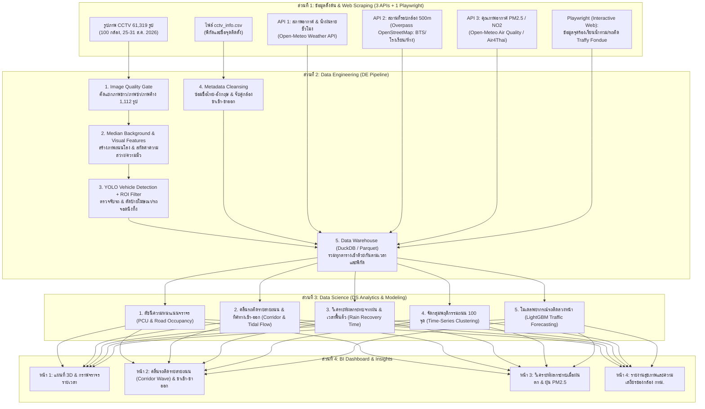
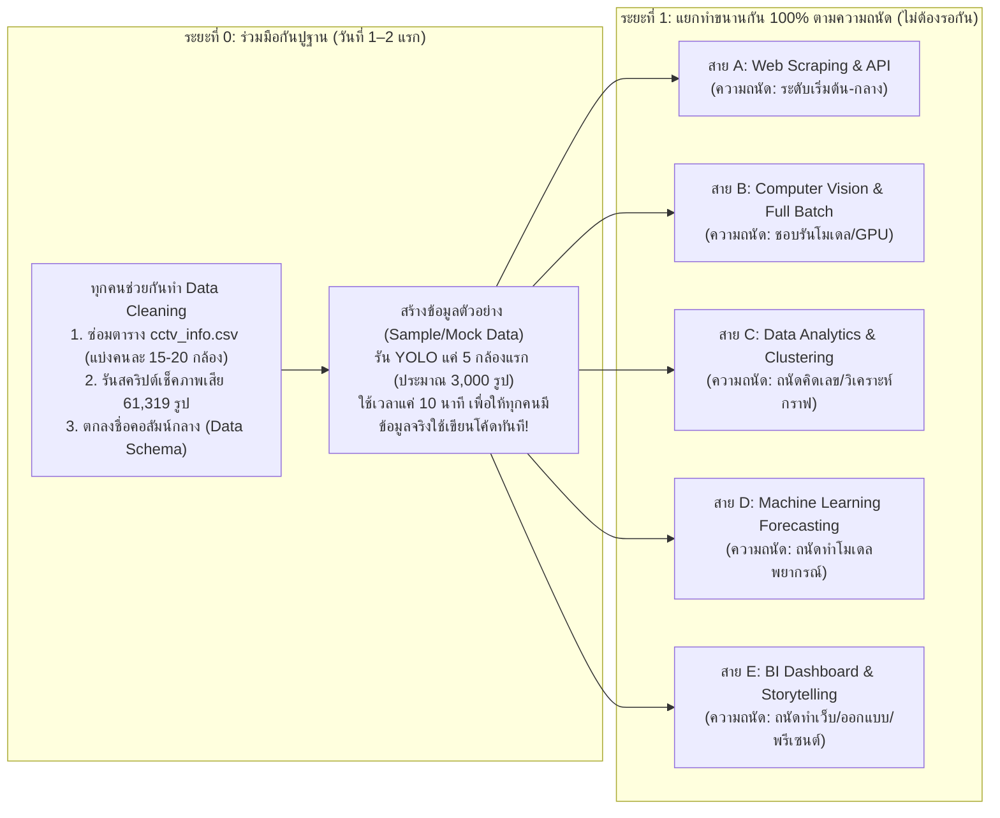

# Project Ideas & Blueprint — Bangkok CCTV Image Analysis (2110403 DSDE)

เอกสารนี้สรุปไอเดียโครงงาน **Data Science & Data Engineering** แบบละเอียดแต่เข้าใจง่าย โดยออกแบบมาให้ **ตอบโจทย์เกณฑ์การให้คะแนนทั้ง 15% ของวิชาอย่างครบถ้วน** และแก้ปัญหาข้อมูลจริงที่เราค้นพบใน [EDA.md](./EDA.md) ได้อย่างตรงจุด

---

## 1. ภาพรวมโจทย์และสิ่งที่โปรเจกต์ต้องมี (Checklist กันพลาด)

ตามเกณฑ์ของวิชา โปรเจกต์ของเราต้องเปลี่ยน **"รูปภาพกล้องวงจรปิด กทม. ดิบๆ 61,319 รูป (100 กล้อง)"** ให้กลายเป็น **"ข้อมูลตาราง (Structured Data)"** เพื่อนำไปวิเคราะห์และสร้าง Dashboard โดยมี **5 ส่วนบังคับ** ดังนี้:

1. **Web Scraping (งานบังคับแยกต่างหาก ไม่นับรวมใน DE):**
   * ต้องดึงข้อมูลเพิ่มจากเว็บทั่วไป/API **อย่างน้อย 3 แหล่ง** *หรือ* ดึงจากเว็บแบบ Interactive (ใช้ Playwright / Selenium) **อย่างน้อย 1 แหล่ง**
2. **Component 1: Data Engineering (DE):**
   * ทำความสะอาดข้อมูล (Data Cleansing) + เตรียมข้อมูล (Data Preparation) + จัดการท่อส่งข้อมูล (Workflow Pipeline) ให้รันได้ตั้งแต่ต้นจนจบ
3. **Component 2: Data Science (DS):**
   * ใช้สถิติ, Machine Learning, หรือการวิเคราะห์เชิงลึกเพื่อหา Pattern ตามช่วงเวลา (Temporal) และสถานที่ (Spatial)
4. **Component 3: BI Dashboard:**
   * หน้าเว็บหรือกระดานสรุปผลที่กดเลือกดูข้อมูล กราฟ และแผนที่ได้ง่าย
5. **Component 4: Insights (ผลลัพธ์และข้อค้นพบ):**
   * สรุปสิ่งที่ค้นพบจากข้อมูลว่าเอาไปใช้แก้ปัญหาจราจรหรือระบบกล้องของ กทม. ได้อย่างไร

---

## 2. ธีมหลักของโปรเจกต์ (Recommended Flagship Idea)

> **ชื่อโปรเจกต์แนะนำ:**
> **"BKK-Pulse: ระบบวิเคราะห์พลวัตการจราจร ความเปราะบางต่อสภาพอากาศ และตรวจสอบสุขภาพเครือข่ายกล้อง CCTV กรุงเทพมหานคร"**
> *(Smart Spatio-Temporal Traffic Dynamics, Weather Vulnerability & CCTV Network Health Analytics)*

### ทำไมไอเดียนี้ถึงโดดเด่นและได้คะแนนสูง?
* **กลุ่มทั่วไปมักทำแค่:** เอารูปเข้าโมเดล YOLO $\rightarrow$ นับจำนวนรถ $\rightarrow$ พล็อตกราฟว่ากี่โมงรถเยอะที่สุด (ซึ่งจะได้ผลลัพธ์ที่ตื้นและโดนหลอกด้วยข้อมูลเสีย เช่น ภาพค้าง หรือป้ายโฆษณาข้างทาง)
* **สิ่งที่โปรเจกต์ของเราจะทำเหนือกว่า:**
  1. **แก้ปัญหาข้อมูลขยะจริงจัง (DE แข็งแกร่ง):** กรองทั้งภาพขาว (504 รูป), ภาพสัญญาณล่ม (33 รูป), ภาพสีเพี้ยน (7 รูป), **ภาพค้างซ้ำเดิม (568 รูป)** และ **ตัดป้ายโฆษณา/รถจอดตายข้างทาง** ออกก่อนนับรถ
  2. **ไม่ได้นับแค่จำนวนคัน แต่คิดเป็น "ขนาดพื้นที่ถนนที่ถูกแย่งไป" (DS ลึกซึ้ง):** มอเตอร์ไซค์ 10 คัน กินที่ถนนไม่เท่ากับรถเมล์ 10 คัน เราจึงแปลงเป็นค่ามาตรฐานวิศวกรรมจราจร (**PCU**) และเทียบสัดส่วนพื้นที่ถนนจริง
  3. **วิเคราะห์ "คลื่นรถติดไล่ตามสายถนนหลัก (Corridor Shockwave) & ทิศทางเข้า-ออกเมือง" ครบทั้ง 100 กล้อง:** แทนที่จะดูเป็นจุดเดี่ยวๆ เรานำกล้องที่เรียงตัวกันบนถนนสายหลัก (เช่น รัชดาภิเษก 14 กล้อง, พหลโยธิน-ลาดพร้าว 12 กล้อง, สาทร-นราธิวาส, ธนบุรี-ราชพฤกษ์) มาสร้าง **Space-Time Heatmap** ดูการลามของรถติดจากแยกสู่แยก พร้อมเจาะลึกคู่กล้องสะพานลอย 6 คู่ (12 กล้อง) ที่ส่องสวนทางกันเป๊ะๆ เพื่อชี้เป้าจุดเปิด **"ช่องทางพิเศษ (Reversible Lane)"**
  4. **เชื่อมโยงกับสภาพอากาศ + สถานที่รอบข้าง + เรื่องร้องเรียนประชาชน:** ตอบได้ว่า *"ทำไมฝนตกเท่ากันแต่ถนนเส้นนี้เป็นอัมพาตนานกว่าเส้นอื่น?"* และ *"กล้องหน้าโรงเรียน vs หน้าห้าง vs ย่านออฟฟิศ มีรูปแบบรถติดต่างกันอย่างไร?"*
  5. **มีพาร์ท "ตรวจสุขภาพระบบกล้อง กทม. (BMA CCTV Audit)":** เอาความผิดปกติของกล้องที่เราเจอใน EDA มาทำเป็น Dashboard ชี้เป้าให้ กทม. ว่าเซิร์ฟเวอร์วงแลนไหน (`IP Subnet`) ล่มบ่อยสุดในตอนเช้า!

---

## 3. แผนผังการทำงานทั้งหมดของระบบ (End-to-End Architecture)

---

## 4. เจาะลึกรายละเอียดแต่ละส่วน (เข้าใจง่าย ทำตามได้จริง)

### ส่วนที่ 1: Web Scraping (เก็บข้อมูลเสริมอย่างไรให้คุ้มค่า ทำได้จริง และไม่โดนบล็อก)

กฎของวิชาคือ: **ดึงแบบธรรมดา/API 3 แหล่ง** หรือ **ดึงเว็บ Interactive (Playwright/Selenium) 1 แหล่ง**
จากการทดสอบระบบจริง เราสามารถดึงข้อมูลย้อนหลังช่วงวันที่ **25–31 ส.ค. 2026** ได้จริงทั้ง 4 แหล่ง แต่มี **ข้อจำกัดทางเทคนิคที่ต้องทำตามนี้เพื่อไม่ให้โค้ดพังหรือวิเคราะห์ผิดพลาด**:

1. **แหล่งที่ 1 (Simple API) — ข้อมูลสภาพอากาศและน้ำฝนรายชั่วโมง (Open-Meteo Historical API):**
   * **ดึงอะไร:** ปริมาณน้ำฝน (`precipitation`), อุณหภูมิ (`temperature_2m`), ความชื้นสัมพัทธ์, ความเร็วลม ตั้งแต่วันที่ 25–31 ส.ค. 2026 ผ่าน `archive-api.open-meteo.com` (ฟรี ไม่ต้องใช้ API Key)
   * **⚠️ ข้อจำกัดจริง & วิธีทำที่ถูกต้อง:**
     * ความละเอียดพิกัด (Grid Resolution) ของ Open-Meteo คือประมาณ **9–11 กม. ($\approx 0.1^\circ$)** ดังนั้นกล้อง 100 ตัวในกรุงเทพฯ จะตกอยู่ในกริดสภาพอากาศเดียวกันประมาณ **6–8 โซนหลัก** (ไม่ใช่มีเซนเซอร์ติดแยกทุกเสากล้อง)
     * **วิธีใช้:** ใช้ดูว่า **วันและชั่วโมงไหนที่โซนนั้นมีฝนตก** แล้วนำไปใช้คู่กับ **"ค่าความมัวของภาพกล้อง (`contrast_std`)"** เพื่อยืนยันว่าที่กล้องตัวนั้นมีฝนตกหนักจริงหรือไม่
2. **แหล่งที่ 2 (Simple API) — ข้อมูลสถานที่สำคัญรอบกล้องในรัศมี 500 เมตร (OpenStreetMap Overpass API):**
   * **ดึงอะไร:** นับจำนวนและระยะทางไปสถานีรถไฟฟ้า BTS/MRT, โรงเรียน/มหาวิทยาลัย, โรงพยาบาล, ห้างสรรพสินค้า และตลาด รอบพิกัดกล้องแต่ละตัว
   * **⚠️ ข้อจำกัดจริง & วิธีทำที่ถูกต้อง:**
     * **ห้ามเขียนลูปยิง API 100 ครั้งแยกทีละกล้องเด็ดขาด!** เพราะเซิร์ฟเวอร์ Overpass จะบล็อกด้วย `HTTP 429 Too Many Requests` ทันที
     * **วิธีที่ถูกต้อง (เสร็จใน 3 วินาที):** ยิง API **เพียง 1 ครั้ง** โดยครอบกรอบพิกัดกรุงเทพฯ ทั้งหมด (`bbox: 13.65, 100.35, 13.90, 100.65`) เพื่อดึงจุดสถานที่ทั้งหมดมาลงเครื่องก่อน แล้วค่อยใช้ Python คำนวณระยะห่าง (`Haversine distance <= 500m`) เทียบกับกล้อง 100 ตัว
     * *(หมายเหตุ: ตัดการดึง "จำนวนเลนถนน" จาก OSM ออก เพราะถนนในไทยกว่า 70% ไม่มีคนกรอกข้อมูลจำนวนเลนไว้ใน OSM)*
3. **แหล่งที่ 3 (Simple API) — ข้อมูลฝุ่น PM2.5 และก๊าซ $\text{NO}_2$ รายชั่วโมง (Open-Meteo Air Quality API):**
   * **ดึงอะไร:** ค่าฝุ่น $\text{PM}_{2.5}$, ก๊าซไนโตรเจนไดออกไซด์ ($\text{NO}_2$ จากไอเสียเครื่องยนต์) และ $\text{CO}$ รายชั่วโมง ผ่าน `air-quality-api.open-meteo.com`
   * **⚠️ ข้อจำกัดจริง & วิธีทำที่ถูกต้อง:**
     * ข้อมูลมลพิษของ Open-Meteo เป็นระดับภูมิภาค (Grid ขนาดใหญ่ ~11–40 กม.) ดังนั้นกล้องในกรุงเทพฯ จะได้ค่ามลพิษใกล้เคียงกันทั้งเมือง **ไม่สามารถนำมาเปรียบเทียบความต่างระหว่างกล้อง A กับกล้อง B ในเวลาเดียวกันได้**
     * **วิธีใช้ที่ถูกต้อง:** ต้องนำมาวิเคราะห์ **เชิงเวลา (Hourly Temporal Trend)** ของภาพรวมทั้งกรุงเทพฯ เช่น เปรียบเทียบกราฟรายชั่วโมงว่า ในช่วงเวลาที่ปริมาณรถรวมทั้งเมืองพุ่งสูงขึ้น ค่าก๊าซ $\text{NO}_2$ และ $\text{PM}_{2.5}$ เฉลี่ยของเมืองขยับขึ้นตามช่วงเวลาเร่งด่วนอย่างไร
4. **แหล่งที่ 4 (Interactive Website ด้วย Playwright / หรือ API เสริม) — ข้อมูลร้องเรียนปัญหาเมืองจาก Traffy Fondue (กทม.):**
   * **ดึงอะไร:** รายการแจ้งเรื่องร้องเรียนของประชาชนใน กทม. (เช่น น้ำท่วมขัง, ไฟจราจรเสีย, จอดรถกีดขวาง) ในช่วงวันที่ 25–31 ส.ค. 2026
   * **⚠️ ข้อจำกัดจริง & วิธีทำที่ถูกต้อง:**
     * ระบบของ Traffy Fondue มีทั้งหน้าเว็บ Interactive (ใช้ **Playwright** เปิดหน้าเว็บ เลื่อนตาราง หรือดักจับข้อมูลเพื่อเก็บคะแนนพาร์ท Interactive Scraping) **และ** มี Public API (`publicapi.traffy.in.th/teamchadchart-stat-api/geojson/v1`) ที่ดึงไฟล์พิกัดจุดร้องเรียนจริงในช่วงวันที่ 25–31 ส.ค. 2026 ออกมาได้ทันที (ทดสอบแล้วมีข้อมูลจริงครบถ้วน!)
     * **แผนกันเหนียว:** ให้เขียนโค้ดทั้งแบบดึงผ่าน API (รับประกันว่าได้ข้อมูลชัวร์ 100% ภายใน 5 วินาที) และเขียนสคริปต์ Playwright เปิดหน้าเว็บไว้โชว์ในโค้ดส่งอาจารย์ด้วย

---

### ส่วนที่ 2: Data Engineering (DE) — ขั้นตอนการเปลี่ยน "รูปภาพขยะปนดี" ให้เป็น "ตารางข้อมูลคุณภาพสูง"

พาร์ทนี้คือหัวใจสำคัญที่ทำให้โปรเจกต์ดูเป็นมืออาชีพ แบ่งเป็น 5 ขั้นตอนย่อยที่ **ตรวจสอบแล้วว่าทำได้จริงภายใต้ข้อจำกัดของภาพความละเอียดต่ำ (`352 × 288` พิกเซล)**:

#### ขั้นตอนที่ 1: คัดกรองภาพเสียอัตโนมัติ (Automated Image Quality Gate) — *[ทำได้จริง 100%]*
ก่อนจะส่งรูปให้ AI นับรถ เราต้องสร้างด่านตรวจจับภาพเสีย 5 รูปแบบที่เราเจอใน EDA เพื่อไม่ให้ข้อมูลเพี้ยน:
* **ด่านที่ 1 (ภาพขาวล้วน 504 รูป):** เช็คว่าถ้าขนาดไฟล์ `< 2,000 bytes` หรือค่าความสว่างเฉลี่ย `mean == 255.0` ให้ตีตราเป็น `white_error`
* **ด่านที่ 2 (ภาพ Rainbow สัญญาณล่ม 33 รูป):** เช็คว่าถ้าขนาดไฟล์ `== 8,782 bytes` (ภาพ `gst-launch-0.10`) ให้ตีตราเป็น `no_signal_error`
* **ด่านที่ 3 (ภาพสีเทา/สีเขียวจากสัญญาณเน็ตกระตุก 7 รูป):**
  * ถ้าค่าความสว่างอยู่ช่วงสีเทากลาง (`127 <= mean <= 132`) และความต่างสีต่ำมาก (`std < 16`) $\rightarrow$ เป็นภาพเสียแบบ **Gray P-Frame** (เห็นแต่เงารถลอยบนพื้นเทา)
  * ถ้าค่าสีเขียวมากกว่าสีแดงและน้ำเงินเกิน 40 หน่วย (`G - R > 40`) $\rightarrow$ เป็นภาพเสียแบบ **Green Screen**
* **ด่านที่ 4 (ภาพค้างซ้ำเดิม 568 รูป — สำคัญมาก!):**
  * เอารูปปัจจุบันเทียบกับรูปก่อนหน้าของกล้องตัวเดียวกัน ถ้าพิกเซลเหมือนกันเป๊ะ 100% (`MAD == 0.0`) ให้ตีตราว่า `is_frozen = True`
  * **เหตุผล:** เช่น กล้อง `150` ค้างตั้งแต่ทุ่มครึ่งของวันที่ 26 ส.ค. ยาวไปจนถึงเก้าโมงเช้าของวันที่ 27 ส.ค. ถ้าไม่กรองออก ระบบจะเข้าใจผิดว่าตอนตีหกถึงแปดโมงเช้ามีรถวิ่งอยู่เท่าเดิมตลอดเวลา!
* **ด่านที่ 5 (ดึงเวลาจากชื่อไฟล์เท่านั้น):**
  * ห้ามใช้เวลาที่พิมพ์อยู่บนมุมรูปภาพเด็ดขาด เพราะมีหลายกล้องที่ไฟดับแล้วเวลาในรูปย้อนกลับไปปี `1970` ให้ดึงวันและเวลาจากชื่อไฟล์ (`YYYYMMDD_HHMMSS.jpg`) เสมอ

#### ขั้นตอนที่ 2: การจัดการภาพมืด/แสงไฟฟุ้ง และการสร้างภาพพื้นหลังถนนโล่ง — *[ปรับให้ตรงความเป็นจริง]*
* **❌ สิ่งที่ทำไม่ได้จริง (ควรเลี่ยง):**
  * การใช้ฟิลเตอร์แต่งภาพ (เช่น CLAHE) เพื่อหวังให้โมเดล YOLO มองเห็นรถที่ซ่อนอยู่ในแสงไฟหน้ารถที่ส่องขาวโพลน (`RGB = 255`) **ทำไม่ได้จริง** เพราะเม็ดพิกเซลบริเวณแสงฟุ้งสูญเสียรายละเอียดตัวรถไปหมดแล้ว และการทำ CLAHE บนภาพความละเอียดต่ำ (`352 × 288`) จะยิ่งขยายรอยแตกของภาพ JPEG (Block Artifacts) จน YOLO ทายผิดมากกว่าเดิม
* **✅ สิ่งที่ทำได้จริงและได้ผลดีมาก:**
  1. **ส่งภาพต้นฉบับเข้าโมเดล YOLO โดยตรง** (ไม่ต้องแต่งสีภาพก่อนเข้าโมเดล)
  2. **สร้าง "ภาพพื้นหลังถนนโล่ง (Median Background Image)" ประจำแต่ละกล้อง:** นำรูปภาพช่วงกลางวัน 50 รูปของกล้องตัวนั้นมาหา **ค่ามัธยฐาน (Median) ของแต่ละพิกเซล** รถที่วิ่งผ่านไปมาจะหายไปหมด เหลือแต่ภาพถนนโล่งๆ
  3. **คำนวณค่า "สัดส่วนพิกเซลที่เปลี่ยนไปจากถนนโล่ง (`foreground_ratio`)" เป็นตัวแปรเสริม:** เมื่อนำภาพปัจจุบันมาลบกับภาพถนนโล่ง เราจะได้สัดส่วนพื้นที่ที่มีวัตถุอยู่บนถนน ซึ่งใช้ช่วยประเมินความหนาแน่นของรถในยามค่ำคืนหรือตอนฝนตกหนักที่ YOLO มองเห็นตัวรถได้ไม่ครบ!

#### ขั้นตอนที่ 3: สกัดข้อมูลรถและสภาพถนนจากภาพด้วย YOLO — *[ทำได้จริง แต่ต้องระวังข้อจำกัดภาพเล็ก]*
ใช้โมเดลตรวจจับวัตถุ **YOLOv8 หรือ YOLOv11 (รุ่น `n` หรือ `s` เพื่อความเร็ว)** สกัดข้อมูลจากแต่ละภาพ:
* **⚠️ ข้อจำกัดจริงของภาพ `352 × 288` พิกเซล:**
  * โมเดลจะตรวจจับรถในระยะใกล้ถึงระยะกลางของภาพได้ดี แต่ **รถที่อยู่ไกลสุดสายตา (ขนาดเล็กกว่า `10 × 10` พิกเซล) โมเดลจะมองไม่เห็น** ดังนั้นตัวเลขที่นับได้คือ **"จำนวนรถในโซนหน้ากล้อง ( Active Detection Zone)"** ไม่ใช่จำนวนรถทั้งเส้นถนน
* **ข้อมูลที่สกัดออกมาได้จริงในตาราง:**
  1. **จำนวนรถและขนาดพื้นที่กรอบรถแยกตามประเภท:** รถยนต์นั่ง (`car`), รถจักรยานยนต์ (`motorcycle`), รถเมล์/รถบัส (`bus`), รถบรรทุก (`truck`) โดยตั้งค่า `conf=0.25`
  2. **กรอง "ป้ายโฆษณาข้างทาง" และ "รถจอดตาย" อัตโนมัติ (Stationary Box Filter):**
     * **วิธีทำที่แม่นยำ:** เนื่องจากกรอบ YOLO ของป้ายโฆษณา (เช่น ป้ายมอเตอร์ไซค์บนเสา BTS ใน `image-4.png`) อาจขยับพิกัดเล็กน้อย $\pm 5$ พิกเซลในแต่ละรูป และตอนกลางคืนอาจมองไม่เห็นป้าย ให้แบ่งภาพเป็นตารางกริด (หรือเช็คค่าซ้อนทับ `IoU > 0.65`) **ถ้าพบกรอบรถปรากฏซ้ำที่ตำแหน่งเดิมเกิน 30% ของรูปในช่วงกลางวัน (หรืออยู่นิ่งที่เดิมติดต่อกันเกิน 6 รูป = 1 ชั่วโมง)** ให้ตัดกรอบนั้นทิ้งอัตโนมัติ!
  3. **หาพื้นที่ถนนที่ใช้งานจริงของแต่ละกล้อง (Auto Road ROI Area):**
     * นำกรอบรถที่วิ่งจริงทั้งหมดตลอด 7 วันของกล้องตัวนั้นมารวมกัน (Union Mask) จะได้พื้นที่ถนนจริงของกล้องตัวนั้น โดยกำหนดค่าขั้นต่ำไว้ที่ `15%` ของพื้นที่ภาพทั้งหมด (เผื่อกล้องที่รถน้อยจะได้ไม่เกิดปัญหาตัวหารเล็กเกินไป)
     * *(ข้อควรระวัง: กล้องรหัส `395` มีขนาดภาพ `348 × 261` เล็กกว่ากล้องอื่น ต้องหารด้วย `width × height` จริงของแต่ละรูปเสมอ)*
  4. **สกัดดัชนีสภาพแวดล้อมจากภาพ (Visual Environment Features):**
     * **ความสว่าง (`brightness_mean`):** บอกระดับแสงกลางวัน/ครึ้มฟ้าครึ้มฝน/กลางคืน
     * **ความพร่ามัวจากฝน/หมอก (`contrast_std`):** ตอนฝนตกหนัก (เช่น กล้อง `529` วันที่ 30 ส.ค. 16:05 น.) ภาพจะขาวมัวและค่า `contrast_std` ตกลงอย่างชัดเจน
     * **สัดส่วนแสงฟุ้ง (`glare_ratio`):** สัดส่วนพิกเซลที่สว่างจ้าเกิน `245` เพื่อใช้วัดแสงไฟหน้ารถส่องกล้องในเวลากลางคืน

#### ขั้นตอนที่ 4: ทำความสะอาดตาราง `cctv_info.csv` (Metadata Cleansing) — *[ทำได้จริง 100%]*
สร้างไฟล์ใหม่ชื่อ `cctv_info_cleaned.csv` ที่ซ่อมปัญหาทั้งหมดให้เรียบร้อย:
* แก้ไข `location_en` ที่สลับแถวมั่ว (เช่น พุทธมณฑลสาย 2 ที่ดันเขียนว่าอังรีดูนังค์ หรือราชเทวี) ให้ตรงกับพิกัดจริง
* ลบคำขยะ (`connect BMAcctv`, `17/5000`, `0`, `(See Yellow)`) และเติมชื่อภาษาไทยที่ถูกตัดคำ 28 ตัวอักษรให้สมบูรณ์
* เพิ่มคอลัมน์ใหม่ที่มีประโยชน์ต่อการวิเคราะห์:
  * `district` (เขต), `corridor` (สายถนนหลัก เช่น รัชดาภิเษก, พหลโยธิน, สาทร-นราธิวาส, เมืองเก่า-ดุสิต, ธนบุรี-ตากสิน)
  * `pair_id` และ `direction` (ระบุคู่กล้องที่อยู่ตรงข้ามกัน ว่ารหัสไหนคือ **ขาเข้าเมือง (Inbound)** และรหัสไหนคือ **ขาออกเมือง (Outbound)**)

#### ขั้นตอนที่ 5: จัดเก็บลงฐานข้อมูลวิเคราะห์ (Parquet / DuckDB) — *[ทำได้จริงและเร็วมาก]*
* รวมทุกตารางเข้าด้วยกันเป็นไฟล์ `.parquet` หรือฐานข้อมูล **DuckDB** (เป็นไฟล์เดี่ยวในโปรเจกต์ ไม่ต้องตั้งเซิร์ฟเวอร์ และโหลดเข้า Streamlit Dashboard ได้เร็วระดับมิลลิวินาที)

---

### ส่วนที่ 3: Data Science (DS) — 5 การวิเคราะห์เชิงลึกที่ตรวจสอบแล้วว่าทำได้จริงและไม่โม้เกินข้อมูล

#### 1. สร้างดัชนีความหนาแน่นจราจรมาตรฐาน (PCU & Relative Congestion Index) — *[ทำได้จริง 100%]*
* **ปัญหาของการนับจำนวนคันเฉยๆ:**
  * มอเตอร์ไซค์ 10 คัน กินพื้นที่ถนนไม่เท่ากับรถเมล์ 10 คัน และกล้องแต่ละตัวติดสูง-ต่ำหรือซูมใกล้-ไกลไม่เท่ากัน
* **วิธีทำที่ถูกต้องทางสถิติ:**
  1. แปลงจำนวนรถเป็นหน่วย **PCU (Passenger Car Unit — หน่วยรถยนต์นั่งมาตรฐาน)**:
     $$\text{PCU} = (1.0 \times \text{Car}) + (0.33 \times \text{Motorcycle}) + (2.5 \times \text{Bus}) + (2.5 \times \text{Truck})$$
  2. คำนวณ **Road Occupancy Ratio ($\rho$)** คือ *"ผลรวมพื้นที่กรอบรถทั้งหมด หารด้วย พื้นที่ถนนจริงของกล้องตัวนั้น"*
  3. **สำคัญมาก — แปลงเป็นคะแนนเทียบเคียงภายในกล้องตัวเอง (Normalized Congestion Score `0–100`):** เนื่องจากมุมกล้องแต่ละตัวเห็นพื้นที่ถนนยาวไม่เท่ากัน เราจึงต้องเทียบค่าปัจจุบันกับ **เปอร์เซ็นไทล์ที่ 95 ($P_{95}$) ของกล้องตัวนั้นเอง** เพื่อให้รู้ว่า *"ตอนนี้กล้องนี้แน่นเป็นกี่เปอร์เซ็นต์ของความจุสูงสุดของมัน"* ทำให้เอากล้องทั้ง 100 ตัวมาพล็อตสีเขียว-เหลือง-แดงเทียบกันบนแผนที่ได้แบบยุติธรรม!

#### 2. วิเคราะห์คลื่นรถติดไล่ตามสายถนนหลัก & ทิศทางเข้า-ออกเมือง (Corridor Wave & Directional Flow Analysis) — *[ใช้ครบทั้ง 100 กล้อง + เจาะลึก 6 คู่สะพานลอย]*
* **ทำไมต้องขยายจากแค่คู่กล้องสะพานลอย?**
  * คู่กล้องที่ตั้งบนสะพานลอยเดียวกันและส่องสวนทางกันเป๊ะๆ มี **6 คู่ (12 กล้อง)** ถ้าวิเคราะห์แค่นี้จะเสียดายข้อมูลอีก 88 กล้องที่เหลือ แต่ใน `cctv_info.csv` กล้องเกือบทั้งหมดเรียงตัวอยู่บน **6 สายถนนหลัก (Corridors)** และมีถึง **~75 กล้องที่ระบุทิศทางชัดเจน (`รถมาจาก... มุ่งหน้าไป...`)**
* **วิธีวิเคราะห์ 3 ระดับ (ครอบคลุมทั้ง 100 กล้อง):**
  1. **ระดับสายถนน (Corridor Space-Time Heatmap — ใช้ทุกกล้องบนสายถนนหลัก):**
     * นำกล้องที่เรียงต่อกันบนถนนสายหลัก เช่น **สายรัชดาภิเษก (14 กล้อง เรียงตั้งแต่พระราม 9 $\rightarrow$ เทียมร่วมมิตร $\rightarrow$ ห้วยขวาง $\rightarrow$ สุทธิสาร $\rightarrow$ ลาดพร้าว $\rightarrow$ ศาลอาญา)**, **สายพหลโยธิน–ลาดพร้าว (12 กล้อง)**, **สายสาทร–นราธิวาส–สีลม (10 กล้อง)**, และ **สายธนบุรี–เจริญนคร–ราชพฤกษ์ (12 กล้อง)** มาเรียงตามลำดับพิกัด (แกนตั้ง = ลำดับแยกตามถนน, แกนนอน = เวลา `06:00–21:00` น.)
     * จะเห็นภาพ **"คลื่นรถติด (Traffic Shockwave Propagation)"** ว่าคอขวดเริ่มเกิดที่แยกไหนก่อน แล้วลามไปถึงแยกถัดไปในอีกกี่นาที!
  2. **ระดับทิศทางภาพรวมเมือง (Macro Inbound vs Outbound Flow — ~75 กล้องที่ระบุทิศทาง):**
     * จัดกลุ่มกล้องตามทิศทางการวิ่งของรถเป็น **ขาเข้าศูนย์กลางเมือง (`Inbound`)**, **ขาออกชานเมือง (`Outbound`)**, และ **วิ่งตัดขวาง/จุดตัดสี่แยก (`Cross-Town / Junction`)** เพื่อเปรียบเทียบคลื่นรถเข้าเมืองตอนเช้า vs ออกเมืองตอนเย็นของแต่ละโซน
  3. **ระดับจุดคู่ขนาน (Micro Spotlight — 6 คู่สะพานลอย = 12 กล้อง):**
     * เจาะลึกคู่กล้องบนสะพานลอยเดียวกันที่ส่องสวนทางกันแท้จริง 6 คู่ ได้แก่ ลาดพร้าว Big C (`136`/`137`), พหลโยธิน รพ.พญาไท 2 (`178`/`179`), รัชดาฯ ซอย 30 (`126`/`127`), รัชดาฯ ศาลอาญา (`224`/`225`), พหลโยธิน สวนจตุจักร (`176`/`177`), และเจริญนคร วัดสุวรรณ (`1132`/`1078`)
     * คำนวณดัชนีความไม่สมดุลจากค่า Normalized Score (`0–100`):
       $$\text{Tidal Imbalance} = \frac{\text{Score}_{\text{in}} - \text{Score}_{\text{out}}}{\text{Score}_{\text{in}} + \text{Score}_{\text{out}} + \epsilon}$$
     * ใช้เป็นกรณีศึกษาชี้เป้าว่าจุดไหนและเวลาใดที่รถติดหนักฝั่งเดียวขณะที่อีกฝั่งโล่ง เพื่อเสนอแนะการเปิด **"ช่องทางพิเศษ (Reversible Lane)"**

#### 3. วิเคราะห์ผลกระทบจากสายฝนและเวลาฟื้นตัวของถนน (Rain Impact & Recovery Case Study) — *[ทำได้จริงในรูปแบบ Event Analysis]*
* **⚠️ ข้อจำกัดของข้อมูลจริง:**
  * ข้อมูลภาพถ่ายมีความถี่ทุกๆ **10 นาที** และมีระยะเวลาเก็บข้อมูล 7 วัน (25–31 ส.ค. 2026) ดังนั้นจึงไม่สามารถวัดเวลาฟื้นตัวเป็นระดับนาทีเป๊ะๆ ได้
* **วิธีทำที่ถูกต้อง:**
  * เลือกช่วงเวลาที่เกิดพายุฝนตกหนักจริงในสัปดาห์นั้น (เช่น ช่วงบ่ายวันอาทิตย์ที่ 30 ส.ค. 2026 หรือวันที่กราฟน้ำฝน Open-Meteo และค่าความมัวของภาพขึ้นสูง) มาทำ **Before / During / After Rain Event Analysis**
  * วัดผลเป็นจำนวนเฟรม (**ขั้นละ 10–20 นาที**) ว่าหลังฝนหยุดตก ถนนสายไหนระบายรถกลับสู่ค่าเฉลี่ยปกติได้เร็ว (ภายใน 1–2 เฟรม = 10–20 นาที) และสายไหนที่รถสะสมค้างยาวนานเกิน 1 ชั่วโมง (6+ เฟรม)

#### 4. จัดกลุ่มคาแรกเตอร์ของถนนกรุงเทพฯ ทั้ง 100 จุดด้วย Machine Learning (Clustering) — *[ทำได้จริง 100%]*
* สร้างตารางสรุปพฤติกรรมของแต่ละกล้อง (Feature Vector ประจำกล้อง 100 แถว) เช่น:
  * ค่าเฉลี่ยความหนาแน่นช่วงเช้าวันทำงาน (`07:00–09:00`), ช่วงบ่าย (`11:00–14:00`), ช่วงเย็น (`16:30–19:30`)
  * อัตราส่วนวันหยุดต่อวันทำงาน (`Weekend-to-Weekday Ratio`)
  * สัดส่วนรถมอเตอร์ไซค์ (`Motorcycle Share`) และสัดส่วนรถใหญ่ (`Bus + Truck Share`)
* ใช้ **K-Means Clustering (พร้อมแสดงกราฟ PCA / Radar Chart)** จัดกลุ่มกล้องทั้ง 100 ตัวออกเป็น 4 กลุ่มคาแรกเตอร์ (เช่น กลุ่มหน้าโรงเรียน/ราชการ, กลุ่มย่านออฟฟิศ CBD, กลุ่มย่านการค้าวันหยุด, และกลุ่มคอขวดขนส่ง/สะพานข้ามแม่น้ำ) แล้วนำข้อมูลสถานที่รอบกล้อง 500m จาก OpenStreetMap มาอ้างอิงประกอบ

#### 5. โมเดลพยากรณ์ความหนาแน่นจราจรล่วงหน้า 30 นาที (Short-Term Traffic Forecasting) — *[ปรับตัวแปรให้ทำได้จริงครบ 100 กล้อง]*
* **❌ สิ่งที่ตัดออกเพราะข้อมูลจริงไม่เอื้อ:**
  * ตัดการใช้ *"ข้อมูลจากกล้องต้นทาง (Upstream Camera)"* ออก เพราะกล้อง 100 ตัวกระจายอยู่ทั่วเมือง ไม่ได้เรียงต่อกันเป็นลูกโซ่ทุกแยก และระหว่างทางมีไฟแดงคั่นมากมาย
* **✅ วิธีสร้างโมเดลที่ทำได้จริงและแม่นยำ (LightGBM Forecasting):**
  * สร้างโมเดล **LightGBM** ทำนายคะแนนความหนาแน่นจราจรล่วงหน้า **30 นาทีข้างหน้า ($t + 30\text{ min}$ หรืออีก 3 เฟรมถัดไป)** โดยใช้ตัวแปรต้นที่สร้างได้ครบทั้ง 100 กล้อง:
    1. **Lag Features ของกล้องตัวเอง:** ความหนาแน่นย้อนหลัง `10 นาที`, `20 นาที`, `30 นาที` และค่าเฉลี่ยย้อนหลัง `1 ชั่วโมง`
    2. **Time & Context Features:** ชั่วโมงของวัน (`hour`), วันทำงาน/วันหยุด (`is_weekend`), รหัสสายถนน (`corridor`), จำนวนโรงเรียน/ห้าง/BTS รอบกล้อง
    3. **Weather Features:** ปริมาณน้ำฝน (`rain_mm`) และค่าความมัวของภาพ (`contrast_std`)
  * **⚠️ กฎเหล็กตอนเขียนโค้ดเตรียมข้อมูลเข้าโมเดล:**
    * เนื่องจากข้อมูลเก็บเฉพาะเวลา **06:00 – 21:00 น.** (ไม่มีภาพตอนกลางคืน 21:00 – 06:00 น.) และเช้าวันที่ 27 ส.ค. (06:00 – 08:50 น.) ระบบล่ม **ห้ามดึงค่า Lag ข้ามวันหรือดึงข้ามช่วงเวลาที่ภาพขาดหายเกิน 30 นาทีเด็ดขาด!** (ต้องจัดกลุ่มตาม `cam_id` และ `date` ก่อนทำ `.shift()`)
  * วัดผลด้วยค่า MAE / RMSE เทียบกับ Baseline (Naive Persistence) และแสดงกราฟ **SHAP Feature Importance**

---

### ส่วนที่ 4: BI Dashboard — ออกแบบหน้าจออย่างไรให้กรรมการประทับใจใน 15 นาที

แนะนำให้ใช้ **Streamlit** (เขียนด้วย Python ล้วน สร้างแผนที่ 3 มิติและเอารูปกล้องจริงขึ้นมาโชว์คู่กับกราฟได้ง่ายและสวยที่สุด) โดยแบ่งเป็น **4 แท็บหลัก**:

1. **Tab 1: Bangkok Live Pulse Map (แผนที่ภาพรวมจราจรกรุงเทพฯ)**
   * แผนที่กรุงเทพฯ แสดงจุดกล้อง 100 จุด เป็นสีเขียว-เหลือง-แดง ตามระดับความหนาแน่น (PCU Congestion Score)
   * มีแถบเลื่อนเวลา (Time Slider) เลือกวันและเวลาเพื่อดูการเคลื่อนตัวของคลื่นรถติดทั่วเมือง
   * เมื่อคลิกเลือกกล้องบนแผนที่ จะโชว์ **รูปภาพจริงจากกล้อง + รูปที่ตีกรอบรถแล้ว + กราฟปริมาณรถตลอด 7 วัน** ของจุดนั้น
2. **Tab 2: Corridor Wave & Directional Flow Analyzer (วิเคราะห์คลื่นรถติดรายสายถนน & ขาเข้า-ขาออก)**
   * เลือกดู **Space-Time Heatmap ของ 6 สายถนนหลัก** (เช่น รัชดาภิเษก, พหลโยธิน-ลาดพร้าว, สาทร-นราธิวาส, ธนบุรี-ราชพฤกษ์) เพื่อดูว่าคอขวดเริ่มจากแยกไหนและลามไปแยกไหนตามช่วงเวลา
   * เปรียบเทียบกราฟปริมาณรถ **ขาเข้าเมือง (`Inbound`) vs ขาออกเมือง (`Outbound`)** ทั้งในระดับโซนและเจาะลึกคู่กล้องสะพานลอย 6 คู่ พร้อมแสดงสัดส่วนประเภทรถและกลุ่มคาแรกเตอร์ของถนนจากการทำ Clustering
3. **Tab 3: Weather, Rain & PM2.5 Impact (ผลกระทบจากฝนและสิ่งแวดล้อม)**
   * กราฟเปรียบเทียบวันที่ฝนตกหนัก vs วันฟ้าใส พร้อมตารางจัดอันดับ **"Top 10 แยกที่เปราะบางต่อฝนตกมากที่สุด"**
   * กราฟความสัมพันธ์ระหว่างปริมาณรถเมล์/รถบรรทุก กับค่าฝุ่น $\text{PM}_{2.5}$ และก๊าซ $\text{NO}_2$
4. **Tab 4: BMA CCTV Network Health Audit (รายงานตรวจสอบสุขภาพกล้อง กทม.)**
   * สรุปสถิติภาพเสียทั้งหมด 1,112 ภาพ แยกตามสาเหตุ (ภาพขาว 504, ภาพค้าง 568, สัญญาณล่ม 33, ภาพสีเทา/เขียว 7)
   * กราฟแสดงช่วงเวลาที่เซิร์ฟเวอร์ กทม. ล่มบ่อยที่สุด (06:00–08:50 น.) และจัดอันดับวงแลน (`IP Subnet`) และตัวกล้องที่ต้องส่งช่างไปซ่อมด่วนที่สุด (เช่น กล้อง `150`, `938`, `206`, `939`, `395`, `432`, `1804`)

---

## 5. แนวทางการแบ่งงานแบบขนาน ไม่รอคอยกัน (Parallel & Fault-Tolerant Workflow)

### ปัญหาของการแบ่งงานแบบเดิม (Waterfall Bottleneck)
ถ้าแบ่งงานแบบต่างคนต่างรอ เช่น รอคนทำ Data Cleaning เสร็จ $\rightarrow$ รอคนรัน YOLO 61,319 รูปเสร็จ $\rightarrow$ คนทำ Data Science ค่อยเริ่มเขียนโค้ด $\rightarrow$ คนทำ Dashboard ค่อยเริ่มสร้างหน้าเว็บ **ถ้าคนต้นน้ำติดปัญหาหรือรันโค้ดไม่ผ่าน ทั้งกลุ่มจะกลายเป็นอัมพาตทันที**

### วิธีแก้: แบ่งเป็น 2 ระยะ (ช่วยกันเคลียร์ฐานรากก่อน + แยกทำขนานด้วยระบบ Data Contract)

---

### ระยะที่ 0: "All-Hands Data Cleaning & Setup" (ทุกคนช่วยกันทำให้จบใน 1–2 วันแรก)
อย่างที่คิดไว้ถูกต้องเลยครับ! **งาน Data Cleaning และการจัดระเบียบข้อมูลตั้งต้น ควรช่วยกันทำให้เสร็จเป็นอันดับแรก** เพราะจะได้เข้าใจข้อมูลตรงกันและไม่เป็นภาระของคนใดคนหนึ่ง:

1. **แบ่งกันซ่อมตาราง `cctv_info.csv` (100 กล้อง):**
   * แบ่งกันคนละ **16–20 กล้อง** ช่วยกันเช็คพิกัดใน Google Maps, แก้ชื่อภาษาอังกฤษที่สลับแถว, เติมชื่อเขต (`district`), ชื่อสายถนน (`corridor`) และจับคู่กล้องขาเข้า-ขาออก (`pair_id`, `direction`) ลงใน Google Sheets ร่วมกัน $\rightarrow$ **เสร็จภายใน 1–2 ชั่วโมง!**
2. **รันสคริปต์คัดกรองภาพเสีย (`image_quality_manifest.csv`):**
   * ช่วยกันรันสคริปต์เช็คขนาดไฟล์และค่าสีของรูปทั้ง 61,319 รูป เพื่อติดป้ายว่ารูปไหนดี รูปไหนขาว รูปไหนค้าง (ขั้นตอนนี้ใช้แค่ CPU ธรรมดา รันไม่กี่นาทีก็เสร็จ)
3. **สร้าง "ชุดข้อมูลตัวอย่าง 5 กล้อง (Pilot Sample Dataset)" + ตกลงชื่อคอลัมน์ (Data Contract):**
   * แทนที่จะรอให้รัน YOLO ครบ 61,319 รูป (ซึ่งอาจใช้เวลาหลายชั่วโมงหรือติดบั๊ก) ให้รัน YOLO แบบง่ายๆ กับ **กล้องแค่ 5–6 ตัวแรกก่อน (ใช้เวลาแค่ 10–15 นาที)**
   * พอได้ตารางผลลัพธ์ของ 5 กล้องนี้ปุ๊บ **คนทำ DS และคนทำ Dashboard เอาไฟล์นี้ไปเขียนโค้ดและสร้างหน้าเว็บได้ทันที 100%** พอคนรัน YOLO ทำครบ 100 กล้องเสร็จเมื่อไหร่ แค่เอาไฟล์ใหม่มาวางทับ กราฟและโมเดลทั้งหมดจะอัปเดตเองอัตโนมัติ!

---

### ระยะที่ 1: แบ่งงานตาม "ระดับความถนัด" ให้ทำขนานกันได้ทันที (และมีแผนสำรองถ้าคนไหนติดปัญหา)

เมื่อจบระยะที่ 0 แล้ว สมาชิกแต่ละคนสามารถเลือกงานตามความถนัดและทำไปพร้อมกันได้เลย โดย **ไม่มีใครต้องรอใคร**:

| ลำดับ | บทบาทตามความถนัด | ระดับความยาก / ทักษะที่ใช้ | งานที่ทำขนานได้ทันที | แผนสำรอง (ถ้าคนนี้ติดปัญหา คนอื่นไม่พัง) |
| :---: | :--- | :--- | :--- | :--- |
| **สายที่ 1** | **Web Scraping — สาย API** *(1 คน)* | 🟢 **เริ่มต้น – กลาง** *(Python พื้นฐาน, เรียก API `requests`)* | ดึงข้อมูล 3 แหล่งจาก API: 1. น้ำฝนรายชั่วโมง (Open-Meteo) 2. สถานที่รอบกล้อง 500m (OSM Overpass) 3. ค่าฝุ่น PM2.5 / $\text{NO}_2$ | เป็น API ฟรีที่ไม่ต้องใช้รหัสผ่าน โค้ดสั้นมาก ถ้าดึงแหล่งไหนไม่ได้ ยังมีอีก 2 แหล่งคอยค้ำประกันคะแนน |
| **สายที่ 2** | **Web Scraping — สาย Playwright** *(1 คน)* | 🟡 **กลาง** *(Playwright / Web Automation)* | เขียนสคริปต์ Playwright เปิดหน้าเว็บ Interactive (เช่น Traffy Fondue หรือเว็บสภาพจราจร/อากาศ) เพื่อดึงข้อมูลจุดร้องเรียนน้ำท่วม/รถติด | แยกออกจากสายที่ 1 เด็ดขาด! ถ้าติดปัญหาหน้าเว็บเปลี่ยนโครงสร้าง คะแนน Web Scraping ของกลุ่มก็ยังปลอดภัยเพราะมี 3 APIs จากสายที่ 1 แล้ว |
| **สายที่ 3** | **Computer Vision & DE Pipeline** *(1 คน)* | 🔴 **ค่อนข้างสูง (สายเทคนิค)** *(PyTorch/YOLO, OpenCV, Google Colab/GPU)* | นำโค้ด YOLO มารันกับรูปที่เหลือทั้งหมด 100 กล้อง, สร้างภาพถนนโล่ง (`Median Background`), และเขียนตัวกรองป้ายโฆษณา/รถจอดนิ่ง (`Stationary Filter`) | ถ้าตัวกรองป้ายโฆษณาหรือภาพถนนโล่งติดบั๊ก ให้ส่งผลลัพธ์ YOLO แบบมาตรฐาน (Baseline) ออกมาก่อน เพื่อให้เพื่อนมีข้อมูลครบ 100 กล้อง แล้วค่อยอัปเกรดทีหลัง |
| **สายที่ 4** | **Data Science — สายวิเคราะห์สถิติ & จราจร** *(1 คน)* | 🟡 **กลาง (สายคิดวิเคราะห์/กราฟ)** *(Pandas, สถิติ, การพล็อตกราฟ)* | ใช้ข้อมูลตัวอย่าง 5 กล้องเขียนโค้ดคำนวณดัชนี **PCU**, วิเคราะห์คลื่นรถขาเข้า-ขาออก (**Tidal Flow**), วิเคราะห์เวลาฟื้นตัวหลังฝนตก และทำ **Clustering** จัดกลุ่มถนน | เขียนเป็นฟังก์ชันรอไว้ได้เลยด้วยข้อมูล 5 กล้องแรก ไม่ต้องรอ YOLO รันครบ 100 กล้อง และไม่ต้องใช้ความรู้เรื่องโมเดลซับซ้อน |
| **สายที่ 5** | **Data Science — สาย Machine Learning** *(1 คน)* | 🟠 **กลาง – สูง (สายโมเดล)** *(Scikit-learn, LightGBM, SHAP)* | สร้างโมเดล **LightGBM** ทำนายรถติดล่วงหน้า 30 นาที และวิเคราะห์ตัวแปรสำคัญ (SHAP Feature Importance) | แยกอิสระจากสายที่ 4! ถ้าโมเดลทำนายล่วงหน้ายังจูนไม่เสร็จ พาร์ท DS ของกลุ่มก็ยังมีงานวิเคราะห์และ Clustering ของสายที่ 4 รองรับอยู่แล้ว |
| **สายที่ 6** | **BI Dashboard & Storytelling** *(1 คน)* | 🟢 **เริ่มต้น – กลาง (สายสร้างสรรค์/พรีเซนต์)** *(Streamlit, Plotly, ทำสไลด์, เล่าเรื่อง)* | สร้างโครงหน้าเว็บ **Streamlit 4 แท็บ** ทันทีโดยใช้ข้อมูลซ่อมเสร็จจากระยะที่ 0 (ทำหน้าแผนที่จุดกล้อง + หน้ารายงานสุขภาพกล้องเสีย **เสร็จได้ตั้งแต่วันแรกๆ!**) | หน้า Dashboard แยกเป็น 4 แท็บอิสระ แท็บไหนเพื่อนยังส่งข้อมูลมาไม่ครบ ก็ปิดซ่อนไว้หรือโชว์เฉพาะแท็บที่เสร็จแล้วได้ทันที |

---

## 6. ตารางข้อตกลงข้อมูลกลาง (Data Contract) — กุญแจสำคัญที่ทำให้ไม่ต้องรอกัน

เพื่อให้ทุกคนเขียนโค้ดขนานกันได้ตั้งแต่วันแรก ให้ตกลง **ชื่อไฟล์และชื่อคอลัมน์มาตรฐาน** ร่วมกันตามนี้ (ใครทำเสร็จเมื่อไหร่ แค่นำไฟล์ชื่อนี้มาอัปเดตลงโฟลเดอร์กลาง):

1. **`cctv_info_cleaned.csv` (ช่วยกันทำเสร็จตั้งแต่ระยะที่ 0):**
   * คอลัมน์บังคับ: `cam_id`, `location_th`, `location_en`, `lat`, `lon`, `district`, `corridor`, `pair_id`, `direction` (`Inbound` / `Outbound` / `None`)
2. **`image_quality_manifest.parquet` (ช่วยกันทำเสร็จตั้งแต่ระยะที่ 0):**
   * คอลัมน์บังคับ: `cam_id`, `timestamp`, `filename`, `file_size`, `status` (`valid`, `white_error`, `no_signal_error`, `corrupt_color`, `frozen`), `brightness_mean`, `contrast_std`
3. **`vehicle_counts.parquet` (สายที่ 3 รัน 5 กล้องแรกให้เพื่อนในวันแรก $\rightarrow$ แล้วค่อยรันครบ 100 กล้องมาวางทับ):**
   * คอลัมน์บังคับ: `cam_id`, `timestamp`, `car_count`, `motorcycle_count`, `bus_count`, `truck_count`, `pcu_score`, `road_occupancy_ratio`
4. **`external_weather_poi.parquet` (สายที่ 1 และ 2 ดึงข้อมูลมาใส่):**
   * คอลัมน์บังคับ: `cam_id`, `timestamp`, `rain_mm`, `temp_c`, `pm25`, `no2`, `nearby_school_count`, `nearby_mall_count`, `nearby_transit_count`, `traffy_complaint_count`
