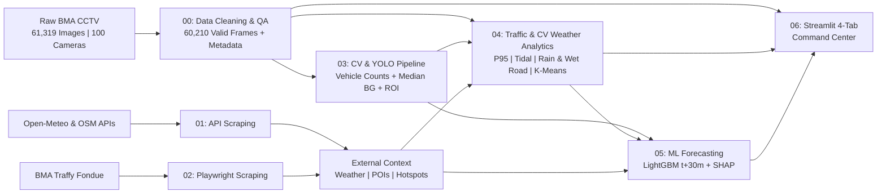

# BKK-Pulse: Bangkok Urban Mobility, Weather Vulnerability & CCTV Network Analytics


> **End-to-End Urban Mobility Intelligence & Infrastructure Reliability Platform for the Bangkok Metropolitan Administration (BMA) CCTV Network**  
> **Course:** 2110403 Data Science and Data Engineering (DSDE-CEDT) -- Faculty of Engineering, Chulalongkorn University

---

## 1. Executive Summary

**BKK-Pulse** is a modular Data Engineering, Computer Vision, and Data Science platform that transforms **61,319 time-series CCTV snapshots** across **100 cameras in Bangkok** (captured at ~10-minute intervals between **August 25-31, 2026**, `06:00-21:00`) into actionable urban traffic intelligence and automated infrastructure maintenance audits.

Rather than treating vehicle detection as a naive bounding-box counting exercise, **BKK-Pulse** addresses real-world physical, optical, and sensor anomalies through four engineering pillars:

1. **Automated Image Quality Gate & Network Health Auditing ([`00_data_cleaning_and_qa/`](00_data_cleaning_and_qa/GOAL.md)):** A 5-stage deterministic image quality filter that isolates blank sensor drops (`white_error`), RTSP pipeline crashes (`no_signal_error`), YUV/P-frame codec corruptions (`corrupt_color`), and frozen camera buffers (`frozen`), paired with spatial metadata enrichment and bilingual location reconciliation (`61,319` raw -> `60,210` valid images).
2. **Multi-Source Urban Context Acquisition ([`01_scraping_apis/`](01_scraping_apis/GOAL.md) & [`02_scraping_traffy_playwright/`](02_scraping_traffy_playwright/GOAL.md)):** Programmatic ingestion of hourly meteorological records (Open-Meteo Archive), city-wide urban air quality context (`PM2.5`, `NO2`, `CO`), surrounding 500m land-use Points of Interest (OpenStreetMap Overpass API), and citizen-reported monsoon flood/traffic hotspots (BMA Traffy Fondue via Playwright browser automation + GeoJSON API).
3. **Computer Vision & Spatio-Temporal Feature Engineering ([`03_cv_yolo_pipeline/`](03_cv_yolo_pipeline/GOAL.md)):** High-throughput single-pass batch vehicle detection supporting multi-class canonical NMS remapping (with locally cached `yolo26x`, `VisDrone`, and `UVH-26` checkpoints), augmented by pixel-level Median Background subtraction (`foreground_ratio`), Stationary Box Filtering (`IoU > 0.65`) to eliminate roadside advertisement boards and parked vehicles, and automated Road ROI masking (`>= 15%` frame floor).
4. **Traffic Engineering Analytics, CCTV Weather Detection, ML Forecasting & BI Command Center ([`04_ds_traffic_analytics/`](04_ds_traffic_analytics/GOAL.md), [`05_ds_ml_forecasting/`](05_ds_ml_forecasting/GOAL.md), [`06_bi_dashboard/`](06_bi_dashboard/GOAL.md)):** Standardized Passenger Car Unit (`PCU`), low-light/glare-adaptive composite density, camera-level **CCTV image-processing rain & wet-road detection** (`visual_rain_flag`, `wet_road_flag`, `rain_severity_score`), per-camera `P95` Congestion Index modeling, corridor shockwave propagation, reversible-lane tidal flow analysis, rainfall recovery quantification, K-Means behavioral clustering, 30-minute ahead LightGBM traffic forecasting with interactive **What-If simulation** and SHAP explainability, and a 4-tab Streamlit decision-support command center.

---

## 2. System Architecture Overview



---

## 3. Team Roster & Module Directory (Parallel Task Architecture)

### Team Ownership & Roles

| Member | GitHub | Primary Modules & Responsibilities | Phase 0 Audit Batch |
| :--- | :--- | :--- | :--- |
| **ปลื้ม** | [@siravidthongsook](https://github.com/siravidthongsook) | `01_scraping_apis`, `02_scraping_traffy_playwright` *(Weather, POIs, Air Quality & Traffy Fondue)* | [Batch 1 -- Ratchadaphisek (17)](00_data_cleaning_and_qa/CAMERA_AUDIT_CHECKLIST.md) |
| **กร** | [@kkooAAA](https://github.com/kkooAAA) | `01_scraping_apis`, `02_scraping_traffy_playwright` *(Weather, POIs, Air Quality & Traffy Fondue)* | [Batch 2 -- Phahon/Lat Phrao/East (16)](00_data_cleaning_and_qa/CAMERA_AUDIT_CHECKLIST.md) |
| **เฟิร์ม** | [@nontaphatfirm](https://github.com/nontaphatfirm) | `03_cv_yolo_pipeline`, `05_ds_ml_forecasting` *(YOLO + Median BG + ROI, LightGBM Forecasting)* | [Batch 3 -- Sathon/Pathum Wan (17)](00_data_cleaning_and_qa/CAMERA_AUDIT_CHECKLIST.md) |
| **สอง** | [@theme222](https://github.com/theme222) | `04_ds_traffic_analytics`, `05_ds_ml_forecasting` *(PCU/P95, Tidal, CV Rain/Wet-Road, K-Means, LightGBM)* | [Batch 4 -- Phetchaburi/Thon Buri (17)](00_data_cleaning_and_qa/CAMERA_AUDIT_CHECKLIST.md) |
| **โม่** | [@moaqilo](https://github.com/moaqilo) | `06_bi_dashboard` *(4-Tab Streamlit BI Command Center & Storytelling)* | [Batch 6 -- Historic Old Town (16)](00_data_cleaning_and_qa/CAMERA_AUDIT_CHECKLIST.md) |
| **นิว** | [@Pranithi-New](https://github.com/Pranithi-New) | Cross-Module Support *(เติมเต็มส่วนอื่นๆ และสามารถ join เข้าช่วยได้ทุกโมดูล)* | [Batch 5 -- Dusit/Rama 5/Samsen (17)](00_data_cleaning_and_qa/CAMERA_AUDIT_CHECKLIST.md) |

### Task Directories (`00_` through `06_`)

This repository is organized into **seven self-contained task directories (`00_` through `06_`)**, orchestrated centrally by [`run_pipeline.py`](run_pipeline.py). Each module has its own `GOAL.md` specification and `src/` directory so all **6 team members** can develop and test in parallel:

| Module | Owner(s) | Core Scope & Deliverables | Specification | Code / Entrypoint | Status |
| :--- | :--- | :--- | :--- | :--- | :--- |
| **`00_data_cleaning_and_qa/`** | All 6 *(Phase 0)* | 5-Stage Image Quality Gate (`61,319` -> `60,210` valid) & 100-camera metadata repair | [`GOAL.md`](00_data_cleaning_and_qa/GOAL.md) / [`Checklist`](00_data_cleaning_and_qa/CAMERA_AUDIT_CHECKLIST.md) | [`clean_dataset_v1.py`](00_data_cleaning_and_qa/src/clean_dataset_v1.py) | `V1 Complete (Peer QA)` |
| **`01_scraping_apis/`** | **ปลื้ม**, **กร** *(+ นิว support)* | **3 Simple APIs:** Open-Meteo Weather, OSM Overpass POIs (500m), Open-Meteo Air Quality | [`GOAL.md`](01_scraping_apis/GOAL.md) | [`01_scraping_apis/src/`](01_scraping_apis/src/README.md) | `Spec Ready` |
| **`02_scraping_traffy_playwright/`** | **ปลื้ม**, **กร** *(+ นิว support)* | **Interactive Playwright:** BMA Traffy Fondue flood/traffic monsoon hotspots & spatial matching | [`GOAL.md`](02_scraping_traffy_playwright/GOAL.md) | [`02_scraping_traffy_playwright/src/`](02_scraping_traffy_playwright/src/README.md) | `Spec Ready` |
| **`03_cv_yolo_pipeline/`** | **เฟิร์ม** *(+ นิว support)* | Single-pass YOLO batch inference, Median BG, Stationary Filter (`IoU > 0.65`), Auto ROI | [`GOAL.md`](03_cv_yolo_pipeline/GOAL.md) | [`predict_yolo26x.py`](03_cv_yolo_pipeline/src/predict_yolo26x.py) | `Prototype Ready` |
| **`04_ds_traffic_analytics/`** | **สอง** *(+ นิว support)* | PCU, Adaptive `P95` Congestion Index, Corridor Shockwave, Tidal Flow, CV Rain/Wet-Road Detection, K-Means | [`GOAL.md`](04_ds_traffic_analytics/GOAL.md) | [`04_ds_traffic_analytics/src/`](04_ds_traffic_analytics/src/README.md) | `Spec Ready` |
| **`05_ds_ml_forecasting/`** | **สอง**, **เฟิร์ม** *(+ นิว support)* | Gap-safe `t + 30m` LightGBM forecaster, Naive baseline, What-If model & SHAP | [`GOAL.md`](05_ds_ml_forecasting/GOAL.md) | [`05_ds_ml_forecasting/src/`](05_ds_ml_forecasting/src/README.md) | `Spec Ready` |
| **`06_bi_dashboard/`** | **โม่** *(+ นิว support)* | 4-Tab Streamlit Command Center (Map + Early Warning, Tidal, Weather/What-If, CCTV Health) | [`GOAL.md`](06_bi_dashboard/GOAL.md) | [`06_bi_dashboard/src/`](06_bi_dashboard/src/README.md) | `Spec Ready (Day-1 Data Ready)` |

---

## 4. Core Governance & Reference Documents

- [`GOAL.md`](GOAL.md) -- Master Project Charter, course grading rubric alignment (15% weight), end-to-end data flow, and execution schedule.
- [`DATA_CONTRACT.md`](DATA_CONTRACT.md) -- Strict Parquet schemas, data types, primary keys, and integration snippet shared across all modules.
- [`CONTRIBUTING.md`](CONTRIBUTING.md) -- Git branching workflow, repository hygiene, and coding conventions.
- [`data/README.md`](data/README.md) -- Intermediate and production Parquet artifact catalog.
- [`Dataset_Clean_V1/README.md`](Dataset_Clean_V1/README.md) -- Automated Phase 0 quality gate audit summary.
- [`Info/EDA.md`](Info/EDA.md) -- Exploratory Data Analysis findings on metadata anomalies, camera failures, and optical challenges.

---

## 5. Repository Structure

```text
Data_Science_Project/
├── README.md                              # Project overview & module navigation index
├── GOAL.md                                # Master project charter, rubric alignment & roadmap
├── DATA_CONTRACT.md                       # Shared Parquet table schemas & integration rules
├── CONTRIBUTING.md                        # Team Git workflow, branching & coding conventions
├── run_pipeline.py                        # End-to-end pipeline orchestrator & DATA_CONTRACT validator
├── requirements.txt                       # Python dependencies across all 6 tracks
├── .gitignore                             # Git exclusion rules for large datasets & weights
│
├── 00_data_cleaning_and_qa/               # [Phase 0 - All Members] Image Quality Gate & Metadata QA
│   ├── GOAL.md                            # 5-stage cleaning pipeline & review protocol
│   ├── CAMERA_AUDIT_CHECKLIST.md          # 100-camera verification matrix split across 6 members
│   └── src/
│       ├── README.md                      # Usage guide for data cleaning scripts
│       └── clean_dataset_v1.py            # Production script generating Dataset_Clean_V1/
│
├── 01_scraping_apis/                      # [Task 01 - ปลื้ม, กร] Weather, OSM POI & Air Quality APIs
├── 02_scraping_traffy_playwright/         # [Task 02 - ปลื้ม, กร] Interactive Traffy Fondue Scraping
├── 03_cv_yolo_pipeline/                   # [Task 03 - เฟิร์ม] Computer Vision & Feature Pipeline
│   ├── GOAL.md                            # YOLO batch inference, Median BG, Stationary Filter & Auto ROI
│   └── src/
│       ├── README.md                      # Module structure & batch execution guidelines
│       └── predict_yolo26x.py             # Multi-model YOLO/VisDrone/UVH-26 & SAHI detection script
├── 04_ds_traffic_analytics/               # [Task 04 - สอง] Spatio-Temporal Analytics, CV Rain & Clustering
├── 05_ds_ml_forecasting/                  # [Task 05 - สอง, เฟิร์ม] Short-Term Traffic Forecasting (ML)
├── 06_bi_dashboard/                       # [Task 06 - โม่] Interactive Streamlit BI Dashboard
│   # Note: นิว (@Pranithi-New) supports & joins across modules as needed
│
├── data/                                  # Canonical Parquet tables shared across modules
├── Info/                                  # Course specification PDF, EDA report & design notes
├── models/                                # (Gitignored) Cached YOLO weights & trained LightGBM model
├── Dataset/                               # (Gitignored) Raw BMA CCTV dataset (61,319 images)
└── Dataset_Clean_V1/                      # Cleaned dataset & manifest tables generated by Task 00 (Google Drive QA Ready)
    ├── README.md                          # V1 cleaning summary, Batch 1-6 QA checklist & workflow rules
    ├── CLEANING_CHANGELOG.md              # Mandatory version history & change ledger for final report
    ├── cleaning_summary.json              # Machine-readable quality gate metrics
    ├── cctv_info_cleaned.parquet          # Cleaned & enriched metadata for 100 cameras
    ├── image_quality_manifest.parquet     # Frame-level quality & optical stats for 61,319 frames
    └── cctv_images/                       # (Gitignored) 60,210 valid ASCII-renamed images
```

---

## 6. Quickstart & Environment Setup

```bash
# 1. Create and activate virtual environment
python -m venv .venv
.venv\Scripts\activate          # Windows PowerShell
# source .venv/bin/activate     # macOS / Linux

# 2. Install project dependencies
pip install -r requirements.txt

# 3. Install Chromium browser binary (required for Task 02 Playwright scraper)
playwright install chromium

# 4. Validate existing Parquet tables against DATA_CONTRACT.md
python run_pipeline.py --check-contract

# 5. Run end-to-end pipeline (pilot 5-camera sample mode or full 100-camera mode)
python run_pipeline.py --sample
python run_pipeline.py --all

# 6. Test interactive / CLI YOLO vehicle detection prototype (Task 03)
python 03_cv_yolo_pipeline/src/predict_yolo26x.py --list-models
```
